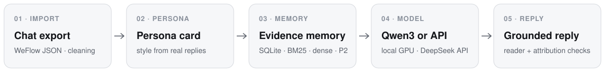
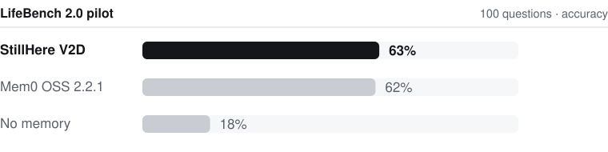

<p align="center">
  <picture>
    <source media="(prefers-color-scheme: dark)" srcset="assets/brand/logo-dark.svg">
    
  </picture>
</p>

<p align="center">
  <strong>An open-source persona and evidence-grounded memory system for personalized AI conversations.</strong>
</p>

<p align="center">
  Turn a chat history into a persona you can talk to. Factual answers are grounded in records retrieved from the conversation.
</p>

<p align="center">
  
  <a href="LICENSE"></a>
  
</p>

<p align="center">
  <a href="docs/quickstart.md"><b>Quickstart</b></a> &nbsp;·&nbsp;
  <a href="docs/index.md"><b>Docs</b></a> &nbsp;·&nbsp;
  <a href="docs/architecture.md"><b>Architecture</b></a> &nbsp;·&nbsp;
  <a href="docs/benchmark.md"><b>Benchmark</b></a>
  <br>
  <b>English</b> &nbsp;·&nbsp; <a href="README.zh-CN.md">简体中文</a> &nbsp;·&nbsp; <a href="README.zh-TW.md">繁體中文</a>
</p>

---

## What is StillHere?

StillHere builds a **personalized AI** from someone's own messages.

- It learns *how* the person writes, as a reviewable **persona card**.
- It keeps *what* was said, as a local, searchable **evidence memory**.
- When you ask about the past, it retrieves the relevant records and answers from them, and it is designed to say "I don't
  remember" rather than invent details.

Run it **local-first** with Qwen3 on your own GPU, or with an **API provider** such as DeepSeek, no GPU required. Training a LoRA
adapter for style is **optional**.

## Highlights

<table>
  <tr>
    <td width="33%" valign="top"><b>Import chat history</b><br>Load a WeFlow (WeChat) JSON export. Speakers, sessions and cleaning are handled; re-imports are incremental.</td>
    <td width="33%" valign="top"><b>Build a persona</b><br>An automatic persona card from real reply statistics. Edit it, version it, roll it back.</td>
    <td width="33%" valign="top"><b>Evidence-based memory</b><br>Hybrid lexical + dense retrieval with a time-aware multi-hop pass, read by a fact reader with attribution checks.</td>
  </tr>
  <tr>
    <td valign="top"><b>Local Qwen or DeepSeek API</b><br>Run Qwen3-8B on a CUDA GPU, or chat through DeepSeek or any OpenAI-compatible endpoint, with explicit opt-in.</td>
    <td valign="top"><b>Optional QLoRA training</b><br>One command builds a resumable Google Colab package; import the trained adapter back with base checks.</td>
    <td valign="top"><b>Reproducible evaluation</b><br>LifeBench workflows with pre-registered rules and audits recomputed from raw records.</td>
  </tr>
</table>

## Quickstart

**A. No GPU: try it with the DeepSeek API** (uses the bundled synthetic chat between Alice and Bob)

```bash
git clone https://github.com/Zamp0x0/StillHere.git && cd StillHere
python -m venv .venv && source .venv/bin/activate      # Windows: .venv\Scripts\Activate.ps1
pip install -e .

stillhere persona quickstart --input examples/synthetic/weflow_demo/alice_bob_weflow.json --speaker contact
stillhere persona status                                # your profile id and the active memory pipeline

export DEEPSEEK_API_KEY=YOUR_API_KEY                    # Windows: $env:DEEPSEEK_API_KEY="YOUR_API_KEY"
stillhere persona chat --profile <profile-id> --answer-provider deepseek_api --answer-model deepseek-flash --allow-external-api
```

Ask *“西湖改到几号了？”* and the answer comes from the chat's own records. With your own WeFlow export, change `--input`.

**B. Run locally with Qwen3:** `stillhere persona download-model base`, then `stillhere persona chat --profile <profile-id> --base-dir <qwen3-8b-dir>`.
See [Quickstart H](docs/quickstart.md#h-chat-with-a-local-qwen3-8b-cuda-gpu).

**C. Train a persona adapter (optional, advanced):** build a Colab package with `stillhere persona package --target colab-l4 --confirm-cloud`.
See [Colab](docs/colab.md) and [Training](docs/training.md).

The complete walkthrough is in [docs/quickstart.md](docs/quickstart.md).

## How it works

<p align="center">
  <picture>
    <source media="(prefers-color-scheme: dark)" srcset="assets/diagrams/workflow-dark.svg">
    
  </picture>
</p>

- **Persona:** reply statistics become a persona card and the prompt that sets the persona's voice.
- **Memory:** every message is archived in SQLite with full-text search; an optional Qwen3-Embedding index adds semantic recall.
- **Retrieval:** the product default is **V2D + P2-A**: hybrid retrieval, plus one bounded second pass for dates, intervals and
  lists. It falls back to lexical automatically when no dense index is available.
- **Reader:** a fact reader answers from the retrieved records. Attribution and grounding checks keep other people's events and
  unsupported details out of the reply.

Learn more in [Architecture](docs/architecture.md) and [Memory](docs/memory.md).

## Benchmark

<p align="center">
  <picture>
    <source media="(prefers-color-scheme: dark)" srcset="assets/benchmarks/lifebench-pilot-dark.svg">
    
  </picture>
</p>

| System | Accuracy |
|---|---:|
| No memory | 18% |
| **StillHere V2D** | **63%** |
| Mem0 OSS 2.2.1 | 62% |

On our 100-question LifeBench pilot, StillHere matched Mem0 OSS with a lighter, evidence-first memory pipeline. Memory
construction needs no LLM calls. Every system used the same answer model, prompt, evidence budget and judge.

**[See benchmark details →](docs/benchmark.md)**

## Documentation

| Get started | Concepts | Going further |
|---|---|---|
| [Installation](docs/installation.md) | [Persona](docs/persona.md) | [Training](docs/training.md) |
| [Quickstart](docs/quickstart.md) | [Memory](docs/memory.md) | [Colab](docs/colab.md) |
| [Supported workflows](docs/SUPPORTED_WORKFLOWS.md) | [Model providers](docs/providers.md) | [Benchmark](docs/benchmark.md) |
| [FAQ](docs/faq.md) · [Troubleshooting](docs/troubleshooting.md) | [Architecture](docs/architecture.md) | [Privacy](docs/privacy.md) · [Limitations](docs/limitations.md) |

## Roadmap

- More chat export formats beyond WeFlow
- English-first persona statistics
- Broader evaluation across more personas
- PyPI packages

## Contributing

Contributions are welcome. See [CONTRIBUTING.md](CONTRIBUTING.md) and our [Code of Conduct](CODE_OF_CONDUCT.md). Please report
security or privacy issues privately as described in [SECURITY.md](SECURITY.md).

## License

[MIT](LICENSE). Models, datasets and fonts used with StillHere keep their own licenses; see
[THIRD_PARTY_NOTICES.md](THIRD_PARTY_NOTICES.md). If you use StillHere in research, please cite it via
[CITATION.cff](CITATION.cff).

<p align="center"><sub>StillHere imitates how someone writes. It is not that person. Use it only with conversations you have the right to use.</sub></p>
