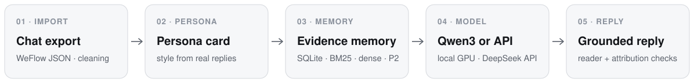
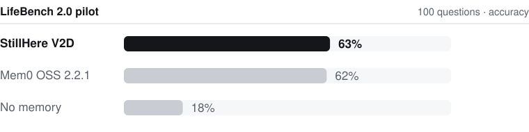

<p align="center">
  <picture>
    <source media="(prefers-color-scheme: dark)" srcset="assets/brand/logo-dark.svg">
    
  </picture>
</p>

<p align="center">
  <strong>一个开源的人物与证据记忆系统，用来构建个性化的 AI 对话。</strong>
</p>

<p align="center">
  把一段聊天记录变成一个可以对话的人物：事实性回答以从聊天中检索到的原始记录为依据。
</p>

<p align="center">
  
  <a href="LICENSE"></a>
  
</p>

<p align="center">
  <a href="docs/quickstart.zh-CN.md"><b>快速开始</b></a> &nbsp;·&nbsp;
  <a href="docs/index.md"><b>文档</b></a> &nbsp;·&nbsp;
  <a href="docs/architecture.md"><b>架构</b></a> &nbsp;·&nbsp;
  <a href="docs/benchmark.md"><b>评测</b></a>
  <br>
  <a href="README.md">English</a> &nbsp;·&nbsp; <b>简体中文</b> &nbsp;·&nbsp; <a href="README.zh-TW.md">繁體中文</a>
</p>

---

## StillHere 是什么？

StillHere 用一个人自己的消息，构建一个**个性化的 AI**：

- 用一张可审阅的**人物卡**，学会这个人*怎么*说话；
- 用一个本地可检索的**证据记忆**，记住聊天里*说过什么*；
- 问到过去的事情时，它先检索相关记录，再根据记录回答。找不到依据时，它的设计是说“不记得了”，而不是编造细节。

它可以**本地优先**运行（在你自己的 GPU 上跑 Qwen3），也可以通过 DeepSeek 等 **API** 使用，完全不需要 GPU。为风格训练 LoRA Adapter 是**可选**的。

## 亮点

<table>
  <tr>
    <td width="33%" valign="top"><b>导入聊天记录</b><br>读取 WeFlow（微信）导出的 JSON，自动识别说话人、切分会话、清洗文本；再次导入是增量的。</td>
    <td width="33%" valign="top"><b>构建人物</b><br>根据真实回复统计自动生成人物卡，可以修改、保留版本、随时回退。</td>
    <td width="33%" valign="top"><b>有证据的记忆</b><br>词法 + 稠密混合检索，加上按时间的多跳补检索；Fact Reader 回答前会做归属检查。</td>
  </tr>
  <tr>
    <td valign="top"><b>本地 Qwen 或 DeepSeek API</b><br>在 CUDA GPU 上运行 Qwen3-8B，或通过 DeepSeek / 任意 OpenAI 兼容接口聊天，外发数据必须显式允许。</td>
    <td valign="top"><b>可选的 QLoRA 训练</b><br>一条命令生成可断点续跑的 Google Colab 训练包，训练好的 Adapter 导回本地时会校验 Base。</td>
    <td valign="top"><b>可复现的评测</b><br>LifeBench 评测流程，判定规则提前登记，结果从原始记录重新计算。</td>
  </tr>
</table>

## 快速开始

**A. 没有 GPU：用 DeepSeek API 体验**（使用仓库自带的合成聊天，Alice 和 Bob 是虚构人物）

```bash
git clone https://github.com/Zamp0x0/StillHere.git && cd StillHere
python -m venv .venv && source .venv/bin/activate      # Windows：.venv\Scripts\Activate.ps1
pip install -e .

stillhere persona quickstart --input examples/synthetic/weflow_demo/alice_bob_weflow.json --speaker contact
stillhere persona status                                # 查看 Profile ID 和实际使用的记忆管线

export DEEPSEEK_API_KEY=YOUR_API_KEY                    # Windows：$env:DEEPSEEK_API_KEY="YOUR_API_KEY"
stillhere persona chat --profile <profile-id> --answer-provider deepseek_api --answer-model deepseek-flash --allow-external-api
```

问一句 *“西湖改到几号了？”*，回答来自聊天记录本身。换成你自己的 WeFlow 导出，只需修改 `--input`。

**B. 本地运行 Qwen3：** 先运行 `stillhere persona download-model base`，再运行 `stillhere persona chat --profile <profile-id> --base-dir <qwen3-8b-dir>`。
详见 [快速开始 H 节](docs/quickstart.zh-CN.md#h-用本地-qwen3-8b-聊天cuda-gpu)。

**C. 训练人物 Adapter（可选，进阶）：** 用 `stillhere persona package --target colab-l4 --confirm-cloud` 生成 Colab 训练包。
详见 [Colab](docs/colab.md) 和 [训练](docs/training.md)。

完整教程见 [docs/quickstart.zh-CN.md](docs/quickstart.zh-CN.md)。

## 工作原理

<p align="center">
  <picture>
    <source media="(prefers-color-scheme: dark)" srcset="assets/diagrams/workflow-dark.svg">
    
  </picture>
</p>

- **人物：** 回复统计生成人物卡和提示词，决定人物说话的方式。
- **记忆：** 每条消息都存进 SQLite 并建立全文检索；可选的 Qwen3-Embedding 索引增加语义召回。
- **检索：** 产品默认使用 **V2D + P2-A**：混合检索之外，针对日期、间隔和列表再做一次有界的补检索。没有稠密索引时，自动退回词法检索。
- **Reader：** Fact Reader 只根据检索到的记录回答；归属检查和 grounding 检查不让别人的事、没有依据的细节进入回复。

详见 [架构](docs/architecture.md) 和 [记忆](docs/memory.md)。

## 评测结果

<p align="center">
  <picture>
    <source media="(prefers-color-scheme: dark)" srcset="assets/benchmarks/lifebench-pilot-dark.svg">
    
  </picture>
</p>

| 系统 | 准确率 |
|---|---:|
| 无记忆 | 18% |
| **StillHere V2D** | **63%** |
| Mem0 OSS 2.2.1 | 62% |

- **结论：** 在 100 题的 LifeBench Pilot 上，StillHere 与 Mem0 OSS 持平，而记忆管线更轻：以证据为先，构建记忆不需要调用 LLM。
- **公平性：** 所有系统使用同一个回答模型、同一个提示词、同样的证据预算和同一个评分方式。

**[查看评测详情 →](docs/benchmark.md)**

## 文档

| 入门 | 概念 | 进阶 |
|---|---|---|
| [安装](docs/installation.md) | [人物](docs/persona.md) | [训练](docs/training.md) |
| [快速开始](docs/quickstart.zh-CN.md) | [记忆](docs/memory.md) | [Colab](docs/colab.md) |
| [支持范围](docs/SUPPORTED_WORKFLOWS.md) | [模型 Provider](docs/providers.md) | [评测](docs/benchmark.md) |
| [常见问题](docs/faq.md) · [故障排除](docs/troubleshooting.md) | [架构](docs/architecture.md) | [隐私](docs/privacy.md) · [局限](docs/limitations.md) |

快速开始有中文版，其余详细文档目前是英文。

## 路线图

- 支持 WeFlow 以外的聊天导出格式
- 面向英文聊天的人物统计
- 覆盖更多人物的评测
- 在 PyPI 发布

## 参与贡献

欢迎贡献代码和文档，请先阅读 [CONTRIBUTING.md](CONTRIBUTING.md) 和 [行为准则](CODE_OF_CONDUCT.md)。安全或隐私问题请按 [SECURITY.md](SECURITY.md) 私下报告。

## 许可

[MIT](LICENSE)。与 StillHere 一起使用的模型、数据集和字体各有许可，见 [THIRD_PARTY_NOTICES.md](THIRD_PARTY_NOTICES.md)。在研究中使用 StillHere，请按 [CITATION.cff](CITATION.cff) 引用。

<p align="center"><sub>StillHere 模仿的是一个人说话的方式，它不是那个人本人。请只使用你有权使用的聊天记录。</sub></p>
