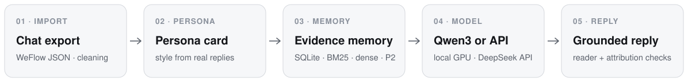
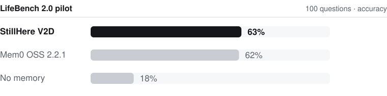

<p align="center">
  <picture>
    <source media="(prefers-color-scheme: dark)" srcset="assets/brand/logo-dark.svg">
    
  </picture>
</p>

<p align="center">
  <strong>一個開源的人物與證據記憶系統，用來打造個人化的 AI 對話。</strong>
</p>

<p align="center">
  把一段聊天紀錄變成一個可以對話的人物：事實性回答以從聊天中檢索到的原始紀錄為依據。
</p>

<p align="center">
  
  <a href="LICENSE"></a>
  
</p>

<p align="center">
  <a href="docs/quickstart.zh-TW.md"><b>快速開始</b></a> &nbsp;·&nbsp;
  <a href="docs/index.md"><b>文件</b></a> &nbsp;·&nbsp;
  <a href="docs/architecture.md"><b>架構</b></a> &nbsp;·&nbsp;
  <a href="docs/benchmark.md"><b>評測</b></a>
  <br>
  <a href="README.md">English</a> &nbsp;·&nbsp; <a href="README.zh-CN.md">简体中文</a> &nbsp;·&nbsp; <b>繁體中文</b>
</p>

---

## StillHere 是什麼？

StillHere 用一個人自己的訊息，打造一個**個人化的 AI**：

- 用一張可審閱的**人物卡**，學會這個人*怎麼*說話；
- 用一個本機可檢索的**證據記憶**，記住聊天中*說過什麼*；
- 問到過去的事情時，它先檢索相關紀錄，再依紀錄回答。找不到依據時，它的設計是說「不記得了」，而不是編造細節。

它可以**本機優先**執行（在你自己的 GPU 上跑 Qwen3），也可以透過 DeepSeek 等 **API** 使用，完全不需要 GPU。為風格訓練 LoRA Adapter 是**選用**的。

## 亮點

<table>
  <tr>
    <td width="33%" valign="top"><b>匯入聊天紀錄</b><br>讀取 WeFlow（微信）匯出的 JSON，自動辨識說話者、切分對話、清理文字；再次匯入是增量的。</td>
    <td width="33%" valign="top"><b>建立人物</b><br>依真實回覆統計自動產生人物卡，可以修改、保留版本、隨時回復。</td>
    <td width="33%" valign="top"><b>有證據的記憶</b><br>詞彙 + 稠密混合檢索，加上依時間的多跳補檢索；Fact Reader 回答前會做歸屬檢查。</td>
  </tr>
  <tr>
    <td valign="top"><b>本機 Qwen 或 DeepSeek API</b><br>在 CUDA GPU 上執行 Qwen3-8B，或透過 DeepSeek／任何相容 OpenAI 的介面聊天，對外傳送資料必須明確允許。</td>
    <td valign="top"><b>選用的 QLoRA 訓練</b><br>一個指令產生可中斷續跑的 Google Colab 訓練套件，訓練好的 Adapter 匯回本機時會檢查 Base。</td>
    <td valign="top"><b>可重現的評測</b><br>LifeBench 評測流程，判定規則事先登記，結果由原始紀錄重新計算。</td>
  </tr>
</table>

## 快速開始

**A. 沒有 GPU：用 DeepSeek API 體驗**（使用專案內附的合成聊天，Alice 與 Bob 是虛構人物）

```bash
git clone https://github.com/Zamp0x0/StillHere.git && cd StillHere
python -m venv .venv && source .venv/bin/activate      # Windows：.venv\Scripts\Activate.ps1
pip install -e .

stillhere persona quickstart --input examples/synthetic/weflow_demo/alice_bob_weflow.json --speaker contact
stillhere persona status                                # 檢視 Profile ID 與實際使用的記憶管線

export DEEPSEEK_API_KEY=YOUR_API_KEY                    # Windows：$env:DEEPSEEK_API_KEY="YOUR_API_KEY"
stillhere persona chat --profile <profile-id> --answer-provider deepseek_api --answer-model deepseek-flash --allow-external-api
```

問一句 *「西湖改到几号了？」*，回答來自聊天紀錄本身（範例聊天是簡體中文）。換成你自己的 WeFlow 匯出，只要修改 `--input`。

**B. 本機執行 Qwen3：** 先執行 `stillhere persona download-model base`，再執行 `stillhere persona chat --profile <profile-id> --base-dir <qwen3-8b-dir>`。
詳見[快速開始 H 節](docs/quickstart.zh-TW.md#h-用本機-qwen3-8b-聊天cuda-gpu)。

**C. 訓練人物 Adapter（選用，進階）：** 用 `stillhere persona package --target colab-l4 --confirm-cloud` 產生 Colab 訓練套件。
詳見 [Colab](docs/colab.md) 與[訓練](docs/training.md)。

完整教學請見 [docs/quickstart.zh-TW.md](docs/quickstart.zh-TW.md)。

## 運作方式

<p align="center">
  <picture>
    <source media="(prefers-color-scheme: dark)" srcset="assets/diagrams/workflow-dark.svg">
    
  </picture>
</p>

- **人物：** 回覆統計產生人物卡與提示詞，決定人物說話的方式。
- **記憶：** 每則訊息都存進 SQLite 並建立全文檢索；選用的 Qwen3-Embedding 索引增加語意召回。
- **檢索：** 產品預設使用 **V2D + P2-A**：混合檢索之外，針對日期、間隔與清單再做一次有界的補檢索。沒有稠密索引時，自動改用詞彙檢索。
- **Reader：** Fact Reader 只依檢索到的紀錄回答；歸屬檢查與 grounding 檢查不讓別人的事、沒有依據的細節進入回覆。

詳見[架構](docs/architecture.md)與[記憶](docs/memory.md)。

## 評測結果

<p align="center">
  <picture>
    <source media="(prefers-color-scheme: dark)" srcset="assets/benchmarks/lifebench-pilot-dark.svg">
    
  </picture>
</p>

| 系統 | 準確率 |
|---|---:|
| 無記憶 | 18% |
| **StillHere V2D** | **63%** |
| Mem0 OSS 2.2.1 | 62% |

- **結論：** 在 100 題的 LifeBench Pilot 上，StillHere 與 Mem0 OSS 持平，而記憶管線更輕：以證據為先，建立記憶不需要呼叫 LLM。
- **公平性：** 所有系統使用同一個回答模型、同一個提示詞、相同的證據預算與同一種評分方式。

**[查看評測詳情 →](docs/benchmark.md)**

## 文件

| 入門 | 概念 | 進階 |
|---|---|---|
| [安裝](docs/installation.md) | [人物](docs/persona.md) | [訓練](docs/training.md) |
| [快速開始](docs/quickstart.zh-TW.md) | [記憶](docs/memory.md) | [Colab](docs/colab.md) |
| [支援範圍](docs/SUPPORTED_WORKFLOWS.md) | [模型 Provider](docs/providers.md) | [評測](docs/benchmark.md) |
| [常見問題](docs/faq.md) · [疑難排解](docs/troubleshooting.md) | [架構](docs/architecture.md) | [隱私](docs/privacy.md) · [限制](docs/limitations.md) |

快速開始有中文版，其餘詳細文件目前為英文。

## 發展方向

- 支援 WeFlow 以外的聊天匯出格式
- 針對英文聊天的人物統計
- 涵蓋更多人物的評測
- 在 PyPI 發布

## 參與貢獻

歡迎貢獻程式碼與文件，請先閱讀 [CONTRIBUTING.md](CONTRIBUTING.md) 與[行為準則](CODE_OF_CONDUCT.md)。安全或隱私問題請依 [SECURITY.md](SECURITY.md) 私下回報。

## 授權

[MIT](LICENSE)。與 StillHere 一起使用的模型、資料集與字型各有其授權，請見 [THIRD_PARTY_NOTICES.md](THIRD_PARTY_NOTICES.md)。在研究中使用 StillHere，請依 [CITATION.cff](CITATION.cff) 引用。

<p align="center"><sub>StillHere 模仿的是一個人說話的方式，它不是那個人本人。請只使用你有權使用的聊天紀錄。</sub></p>
