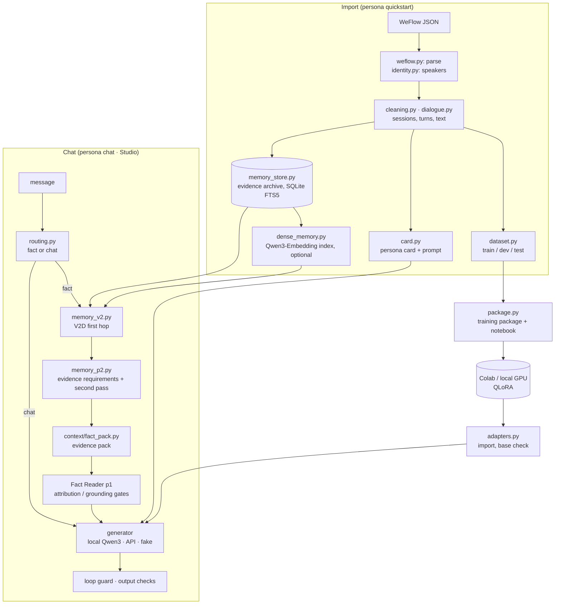

# Architecture

## Overall



## Modules

| Module (`src/stillhere/...`) | Responsibility |
|---|---|
| `persona/weflow.py`, `persona/identity.py` | read WeFlow JSON, identify the two speakers, flag identity anomalies |
| `persona/cleaning.py`, `persona/dialogue.py`, `persona/dataset.py` | sessions (120-minute gap), merged turns, versioned train / dev / test with leakage control |
| `persona/card.py`, `persona/card_admin.py`, `persona/prompt_writer.py` | persona card statistics, prompt rendering, versions, activation, API-assisted drafts |
| `persona/memory_store.py`, `memory/` | the evidence archive (SQLite + FTS5), incremental import, optional semantic memory |
| `persona/dense_memory.py`, `retrieval/` | dense index (Qwen3-Embedding-0.6B), EF1 lexical / dense channels, RRF fusion |
| `persona/memory_v2.py`, `persona/memory_p2.py`, `context/fact_pack.py` | V2 retrieval with evidence windows; P2 second pass; the evidence pack the reader sees |
| `persona/routing.py`, `persona/llm_router.py` | rules router (default) and optional LLM router |
| `persona/runtime.py` | the reply chain: router → retrieval → reader → persona generation → checks |
| `providers/` | DeepSeek, OpenAI-compatible and local providers, per role, with explicit external-API opt-in |
| `persona/package.py`, `persona/training.py`, `persona/adapters.py` | training packages (Colab / local / remote), local training, adapter import |
| `persona/product_config.py`, `persona/final_config.py` | the product memory configuration (V2D + P2) and the frozen research configuration (V2L) |
| `persona/status_report.py`, `persona/cli.py`, `persona/studio.py` | `persona status`, the CLI, the local Studio (127.0.0.1) |

## Data flow and storage

```text
<root>/<profile-id>/
  profile.json                  source file sha, target speaker, privacy flags
  datasets/<version>/           train / dev / test (only for training)
  cards/<card-id>/              persona_card.yaml, persona_prompt.txt, manifest (every version kept)
  memory/memory.sqlite          evidence archive (+ semantic memories if a writer ran)
  indexes/product_dense/        dense index (optional)
  runtime/runtime_config.json   the selected card, adapter, memory pipeline (written by finalize / quickstart)
  packages/<package-id>/        training packages
  adapters/<adapter-id>/        imported adapters
  PIPELINE_STATE.json, LINEAGE.jsonl, logs/
```

## Versions that coexist

| Version | What | Status |
|---|---|---|
| `stillhere.persona.product/2026-11-19-v2d-p2` | V2D + P2 retrieval, Reader p1, EVIDENCE_ONLY writer, adapter off | **default** for new profiles |
| `stillhere.persona.product/2026-11-19-v2d` | V2D without P2 | `--memory-pipeline product-v2d` (rollback) |
| `stillhere.persona.final/2026-11-19` | V2L lexical, Reader p1 | `--memory-pipeline research-final` (the frozen research configuration) |
| no `memory_pipeline` section | the historical V1 path | `--memory-pipeline v1` |

A profile keeps the pipeline it was finalized with; nothing is upgraded silently.
