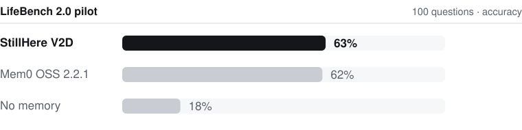
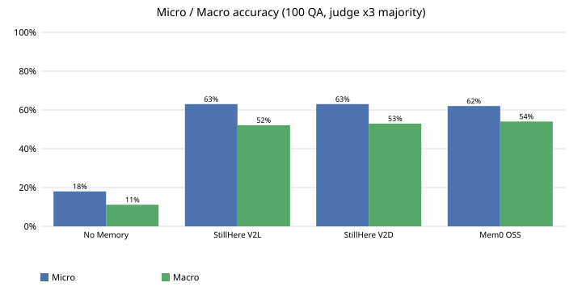
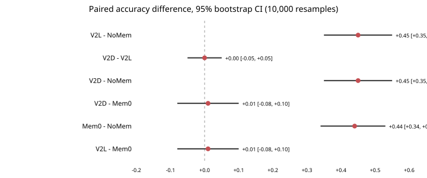
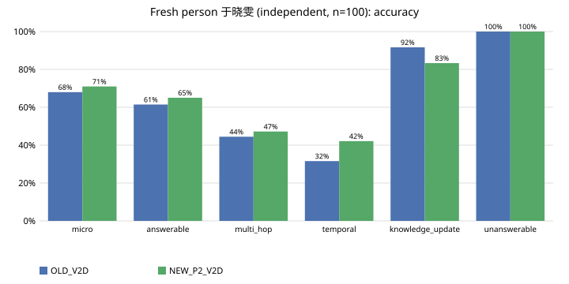
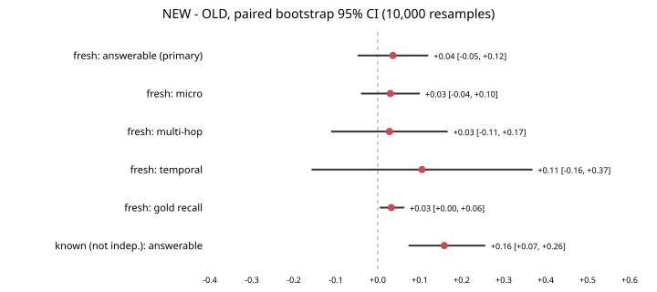

# Benchmarks

  <picture>
    <source media="(prefers-color-scheme: dark)" srcset="../assets/benchmarks/lifebench-pilot-dark.svg">
    
  </picture>

## At a glance

| Study | Result |
|---|---|
| **LifeBench pilot** (1 persona, 100 questions) | StillHere V2D **63%**, Mem0 OSS 2.2.1 62%, no memory 18%. StillHere is on par with Mem0 (the difference is not significant), with no LLM calls to build memory and about 16× lower estimated API cost |
| **P2 memory evaluation** (an independent persona, 100 unseen questions) | P2 raised gold-evidence recall significantly (+3.2 points); the accuracy change, 68 → 71 of 100, was not significant. P2's retrieval part was adopted as the product default |

StillHere's long-term memory was evaluated on **LifeBench 2.0**, a public dataset of synthetic personal timelines (SMS, notes,
calendar, calls, assistant chats) with question sets per persona.

- The two studies use **different personas and different questions**, so their absolute numbers must not be ranked against each
  other.
- Details, protocols and limitations follow below.

## 1. LifeBench pilot: StillHere vs. Mem0 OSS

| | |
|---|---|
| Data | LifeBench 2.0 (`C1754955896/Lifebenchv2.0` @ `3d06052d`), **one persona**, 100 questions (stratified by question type) |
| Systems | no memory (M0), StillHere V2L, StillHere V2D, Mem0 OSS 2.2.1 (the official open-source library with a local vector store; not the hosted Mem0 platform) |
| Same for all | answer model DeepSeek Flash (temperature 0), answer prompt, 4,000-token evidence budget, chronological visibility (each day is added before that day's questions are asked) |
| Judge | the official LifeBench judge prompt (`LifeBench_eval` @ `2bfda547`), DeepSeek Flash, 3 runs, majority vote |

| System | Accuracy (micro) | Answerable | Wrong refusals | Memory construction | Estimated API cost (build + answer) |
|---|---:|---:|---:|---|---:|
| No memory | 18% | — | — | — | — |
| StillHere V2L | 63% | — | — | no LLM calls | — |
| StillHere V2D | 63% | 45/82 | 28/82 | no LLM calls; embedding 312 s on an L4 GPU | ~$0.08 |
| Mem0 OSS | 62% | 44/82 | 33/82 | 872 LLM calls, ~1 h | ~$1.26 |

- **StillHere V2D vs. Mem0:** +1 point, 95% CI [−8, +10], 11 wins / 79 ties / 10 losses, exact McNemar p = 1.0. **Not
  significant: the systems are on par.**
- **Cost:** the "~16× lower" figure covers API cost for memory construction plus answering. GPU time for the embedding index and
  the judge cost are not included.
- **Retrieval latency** (p50): 479 ms for StillHere V2D, 217 ms for Mem0.
- **Validity:** 15 of the 100 questions had been referenced in earlier exploratory work on this persona. This was recorded as
  `PERSONA_SEEN_QA_PARTLY_SEEN`; it does not favour either system, because both answered the same questions and StillHere was not
  tuned on them.

  
  

## 2. P2 memory evaluation (independent persona)

P2 adds evidence requirements and a bounded second retrieval pass (see [memory.md](memory.md)). It was designed from a root-cause
analysis of the pilot's errors: most errors came from missing second-hop evidence, none from refusing despite sufficient
evidence. It was then tested once on a **fresh persona** with 100 questions never used in development.

| | |
|---|---|
| Protocol | registered before any result (adoption rules A–G: completeness; answerable accuracy not lower; unsupported answers ≤ old + 2; unanswerable accuracy ≥ old − 1; no leakage; at least one targeted gain with micro not lower; token / latency limits) |
| Groups | OLD = V2D exactly as in the pilot (code fingerprinted); NEW = V2D + P2 (same store, same days, same model, same judge, same budget) |
| Integrity | results recomputed independently from the raw records; all 300 contexts re-created byte-identically on CPU |

| Metric | OLD (V2D) | NEW (V2D + P2) | Difference |
|---|---:|---:|---:|
| Micro accuracy | 68/100 | 71/100 | +0.03 [−0.04, +0.10] |
| Answerable accuracy (primary) | 51/83 | 54/83 | +0.036 [−0.048, +0.120] (8 / 70 / 5, p = 0.58) |
| Unanswerable (correct refusal) | 17/17 | 17/17 | 0 |
| Multi-hop | 16/36 | 17/36 | +1 |
| Temporal | 6/19 | 8/19 | +2 |
| Wrong refusals | 28/83 | 23/83 | −5 |
| Unsupported answers | 8 | 10 | +2 (the registered limit) |
| Gold-evidence recall | 56.1% | 59.3% | **+3.2 points [+0.5, +6.3]** |
| Retrieval latency p50 (L4) | 506 ms | 813 ms | 1.6× |

- **Decision:** `ADOPT_P2` by the registered rule.
- **The accuracy gain is not statistically significant.** The recall gain is significant.
- **The 71% is the full benchmark configuration:** P2 retrieval plus a calendar note, a coverage note and an adjusted answer
  prompt. The product adopts only the **P2 retrieval** part, whose recall gain is the measured effect, so 71% is not an end-to-end
  product accuracy.
- **Mechanism:** the clearest gain is on "N days later / before" questions (2/7 → 6/7 correct). Losses came mainly from extra
  evidence pushing other evidence out of the token budget.
- **Do not rank against Mem0:** this persona and these questions differ from the pilot, so 68% / 71% cannot be compared with Mem0's
  62%.

  
  

## Limitations

- **Small samples:** one persona per study, 100 questions each; confidence intervals are wide.
- **Same-family judge:** the answer model and the judge are the same model family (DeepSeek Flash).
- **Not a full LifeBench run:** these are pilots, not leaderboard results.
- **Benchmark ≠ product:** the benchmark answers with one shared answer function, not the product's Reader p1 and safety gates.
- **No per-module ablation of P2.**

See [limitations.md](limitations.md).

## Reproducing

The evaluation code is in `evaluation/lifebench_pilot/` (pilot) and `evaluation/p2_final_memory/` (P2).

1. **Download the official dataset** at the pinned revision; the scripts verify its sha256.
2. **Clone `LifeBench_eval`** at the pinned commit for the official judge prompt; it is not redistributed here.
3. **Build an evaluation package** with the `build_release.py` scripts. They produce a Colab notebook and an input ZIP.
4. **Run it on a Colab GPU**, with a DeepSeek key in Colab Secrets. Costs are capped by the protocol.
5. **Recompute the metrics** from the raw records with the audit code (`final_audit.py`, `metrics_p2.py`).

The P2 package also expects the pilot's stored OLD records for its known-set regression. Those raw result files are not part of
this repository, so a public re-run starts from the pilot.
