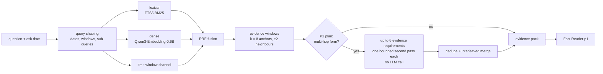

# Memory

StillHere's memory is **evidence first**: the original messages are the memory. Answers are built from retrieved records, and a
reader checks them before the persona speaks.

## Storage

- `memory/memory.sqlite` per profile: every message with time, speaker, conversation and source locator, indexed with **FTS5**
  (BM25).
- **Incremental import:** `stillhere persona memory-build --profile <id> --source <newer-export.json>` adds only new messages. A
  repeated import adds `0`. An edited message keeps the original and records a conflict.
- **Semantic memory (optional):** a writer model can extract facts from sessions (`--writer hf` on a local GPU, or
  `--writer deepseek --allow-external-api`). The default writer mode for the product is **EVIDENCE_ONLY**: answers rely on the
  original records, not on extracted facts.

## Retrieval pipeline



| Stage | Details |
|---|---|
| Lexical | FTS5 / BM25 over messages, with character-level matching for Chinese (no word segmenter needed) |
| Dense | Qwen3-Embedding-0.6B @ `97b0c614`, 1024-d; index in `indexes/product_dense/`; CPU or GPU |
| Fusion | reciprocal-rank fusion of the channels; explicit dates in the question are preferred (`date_mode = prefer`) |
| Evidence windows | 8 anchor records, each with 2 neighbours before and after; nothing after the ask time |
| P2 | see below |
| Budget | the evidence pack is trimmed by rank to fit the model context |

### P2: evidence requirements and one bounded second pass

P2 recognises question forms that need evidence from another day than the one the question mentions. Each form becomes a
requirement with its own time window:

- a date offset ("N 天后 / 之前 / 前一天");
- an event anchor ("the day before the visit in June"), resolved in two hops;
- an enumerated list ("1. … 2. …");
- several explicit dates;
- a month pattern;
- the days before a planned date;
- "recently".

Each requirement is searched **once** in its window:

- it shares one retrieval per distinct query;
- it uses a smaller candidate pool for list items;
- it never makes an LLM call;
- windows are clipped at the ask time.

The results are deduplicated and interleaved with the first pass, and list items join after the first pass's top three anchors.
`meta["p2"]` records the requirements, the coverage and the time spent.

Questions that match no form are answered from the first pass alone, which is identical to V2D without P2.

## Versions

| Label | Meaning |
|---|---|
| V1 | the historical pipeline (no `memory_pipeline` section) |
| V2L | V2 lexical: FTS5 + windows (the frozen research configuration) |
| V2D | V2 hybrid: lexical + dense |
| V2D + P2 | V2D + the P2 second pass (**product default**) |

`ACTIVE_MEMORY_PIPELINE` reports what actually runs:

| Label | When |
|---|---|
| `V2D_P2` | dense index and embedding model available |
| `V2L_P2_FALLBACK` | dense configured but unavailable (no model, no index, no torch); chat continues lexically and prints a `note:` |
| `V2D` / `V2L_FALLBACK` | the `product-v2d` rollback |
| `V2L` | `research-final` |
| `V1` / `OFF` | no section / memory disabled |

```bash
stillhere persona status --profile <id>                       # expected pipeline from the files on disk
stillhere persona chat --profile <id> ...                     # prints the pipeline that actually runs
stillhere persona memory-build --profile <id> --dense         # build / update the dense index
stillhere persona memory-query --profile <id> --q "..."       # inspect retrieval (prints private text locally)
stillhere persona memory-audit --profile <id>                 # imported / searchable / retrievable report
stillhere persona finalize --profile <id> --memory-pipeline product|product-v2d|research-final|v1
```

## Reader and safety gates

- **Fact Reader p1:** answers only from the evidence pack. It decides whose fact a question is about. A question that mixes 你 and
  我 is treated as about both people, never as about the other person only.
- **Attribution gate:** refuses an answer that turns another person's words or events into the persona's own. Example: the
  sister's wedding stays the sister's.
- **Grounding gate:** refuses an answer whose key details (numbers, names, short spans) are not in the evidence.
- **Answer preservation:** when the persona model rephrases the reader's answer, the key details must survive. Otherwise the
  reader's answer is used.
- **Unknown stays unknown:** with no supporting record, the persona says it does not remember instead of guessing.

The same chain runs for local models and API models.
