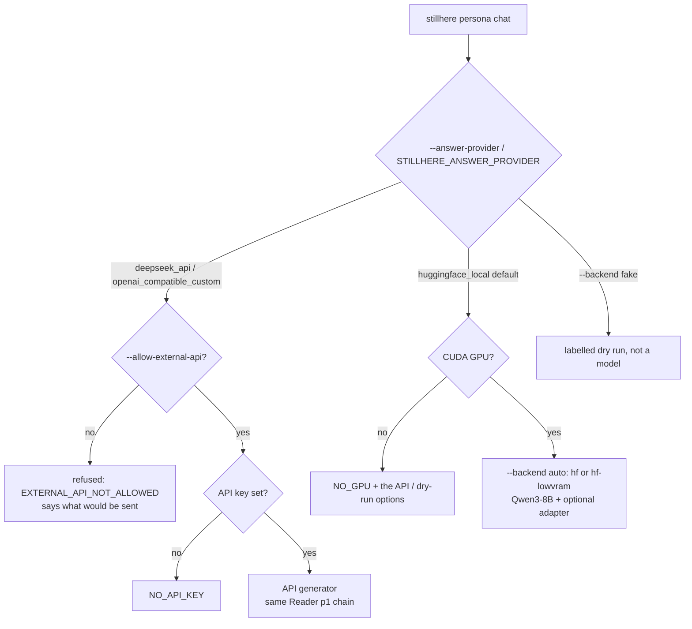

# Model providers

## Roles

Each role is configured separately; there is no single global model.

| Role | Used for | Default |
|---|---|---|
| `answer` | persona chat and the Fact Reader | `huggingface_local` (local Qwen3-8B) |
| `card_assist` | API-assisted persona card drafts | `deepseek_api` |
| `memory_extraction` | the optional memory writer | `huggingface_local` |
| `router` | the optional LLM router (classification only) | `deepseek_api` |
| `judge` | evaluation only | `deepseek_api` |

## Choosing a provider



## Provider kinds

| Provider | Notes | Verified |
|---|---|---|
| `deepseek_api` | `https://api.deepseek.com/chat/completions`; default model `deepseek-flash`; thinking disabled, temperature 0 | real API, synthetic data |
| `openai_compatible_custom` | any OpenAI-compatible endpoint: needs `base_url` and `model`; key in `STILLHERE_CUSTOM_API_KEY` (or the variable named by `..._API_KEY_ENV`) | CPU tests only |
| `huggingface_local` | a local Qwen3-8B (pinned revision) or another directory via `--base-dir` / `STILLHERE_BASE_MODEL_DIR`; the chat template is checked | on Colab L4 / A100 GPUs |
| `fake` | tests and labelled dry runs only; never used as a silent fallback | CPU |

**Local models:** only Qwen3-8B (and chat models with a compatible Qwen3 chat template) are supported. Arbitrary Hugging Face models
are not tested. An adapter loads only on the base it was trained on.

## Configure

Precedence, later wins: role defaults < `.env` < environment variables < the profile's `runtime/settings.json` `providers` block
< command-line flags.

Environment variables per role (`<ROLE>` upper case):

```text
STILLHERE_<ROLE>_PROVIDER / _MODEL / _BASE_URL / _API_KEY_ENV / _TEMPERATURE / _MAX_OUTPUT_TOKENS / _TIMEOUT_S / _MAX_ATTEMPTS / _MODEL_DIR
```

Example `.env` for DeepSeek chat:

```text
DEEPSEEK_API_KEY=YOUR_API_KEY
STILLHERE_ANSWER_PROVIDER=deepseek_api
STILLHERE_ANSWER_MODEL=deepseek-flash
STILLHERE_ALLOW_EXTERNAL_API=1
```

Or per command:

```bash
stillhere persona chat --profile <profile-id> --answer-provider deepseek_api --answer-model deepseek-flash --allow-external-api
stillhere persona chat --profile <profile-id> --answer-provider openai_compatible_custom --answer-base-url https://your-endpoint/v1 --answer-model your-model --allow-external-api
```

Inspect and test:

```bash
stillhere persona provider show                                     # effective configuration, keys masked
STILLHERE_ANSWER_PROVIDER=deepseek_api stillhere persona provider check --role answer --allow-external-api   # one tiny request
```

## Data leaving your machine

- A role set to an API provider sends private content.
  - Chat sends the persona prompt, the retrieved evidence records and your message.
  - The writer sends whole sessions.
  - `card assist` sends style statistics, plus example replies with `--send-examples`.
- Nothing is sent without `--allow-external-api` or `STILLHERE_ALLOW_EXTERNAL_API=1`. The refusal names what would be sent and
  to whom.
- Keys are read only from the environment or `.env`, never stored in configs, logs or results, and masked in errors.
- Requests use bounded retries. 4xx errors such as 401 (bad key) are not retried. Usage logs record token counts and cost
  estimates, never content.
