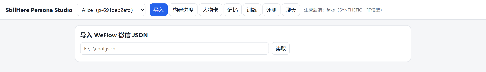

# Quick start: from a chat export to a persona you can talk to

**English** · [简体中文](quickstart.zh-CN.md) · [繁體中文](quickstart.zh-TW.md)

This walkthrough uses the **synthetic** chat in `examples/synthetic/weflow_demo/`. Alice and Bob are invented people. Every
command below was run on this example; outputs are shortened and marked **Example output**. Paths are shown for Linux / macOS;
on Windows they look like `C:\Users\<you>\.stillhere\personas\...`.

| Part | You need | Time |
|---|---|---|
| [A. Install](#a-install) | Python 3.10+ | 2 min |
| [B. Build a persona (CPU only)](#b-build-alices-persona-cpu-only) | nothing else | 1 min |
| [C. Chat through the DeepSeek API](#c-chat-through-the-deepseek-api-no-gpu) | a DeepSeek API key | 2 min |
| [D. Better memory: dense retrieval](#d-better-memory-dense-retrieval-optional) | ~1.2 GB download, CPU is fine | 10 min |
| [E. Edit the persona card](#e-edit-the-persona-card) | — | 3 min |
| [F. Update with a newer export](#f-update-the-memory-with-a-newer-export) | — | 1 min |
| [G. A second persona](#g-a-second-persona) | — | 1 min |
| [H. Local GPU chat](#h-chat-with-a-local-qwen3-8b-cuda-gpu) | NVIDIA GPU, ~16 GB download | — |
| [I. Train an adapter on Colab](#i-train-a-persona-adapter-on-google-colab-optional) | Google account | ~1 h |
| [J. Your own chat](#j-use-your-own-chat) | a WeFlow JSON export | — |
| [Troubleshooting](#troubleshooting) | | |

---

## A. Install

```bash
git clone https://github.com/Zamp0x0/StillHere.git StillHere
cd StillHere
python -m venv .venv
source .venv/bin/activate              # Windows PowerShell: .venv\Scripts\Activate.ps1
pip install -e .
stillhere --help
```

- **What it does:** installs the `stillhere` command. The core needs only PyYAML; no ML libraries.
- **Check:** `stillhere --help` lists `version`, `demo`, `loop-guard` and `persona`; `stillhere persona --help` lists every
  persona command.
- **If it fails:** `stillhere: command not found` means the virtual environment is not active. Activate it again, or run
  `python -m stillhere.cli --help`.

## B. Build Alice's persona (CPU only)

### B1. Look at the export first (read-only)

```bash
stillhere persona inspect --input examples/synthetic/weflow_demo/alice_bob_weflow.json
```

**Example output:**

```text
parse:
  messages_in_file: 966
  types: {文本消息: 957, 图片消息: 9}
  first: 2025-03-01T09:21:00+08:00
  last: 2025-06-08T12:29:00+08:00
identity:
  speakers:
    - {"id": "u_fc7273fa69a1", "role": "contact", "messages": 562, "text_messages": 553, ...}
    - {"id": "u_664256a83568", "role": "self", "messages": 404, "text_messages": 404, ...}
  anomalies: []
```

`contact` is the other person in the export (Alice); `self` is the account that made the export (Bob). This command writes nothing.

### B2. Quickstart: profile, cleaning, persona card, memory

```bash
stillhere persona quickstart --input examples/synthetic/weflow_demo/alice_bob_weflow.json --speaker contact
```

Without `--speaker` the command shows the two people and asks you to choose. `--speaker contact` picks Alice.

**Example output:**

```text
Detected speakers:
[1] Alice — 联系人 (contact) — 553 text — 2025-03-01 … 2025-06-08
[2] Bob — 导出账号 (self) — 404 text — 2025-03-01 … 2025-06-08
profile_id: p-691deb2efd
overall: PARTIAL_READY
dense:
  status: SKIPPED
  reason: no local Qwen3-Embedding-0.6B: the product memory runs V2L (lexical)
stages: {01..08: PASS, 09: PENDING, 10: PASS, 11: PASS, 16: PASS, 17: PARTIAL_READY}

not PASS (chat still works unless the stage is 06 / 07 / 16):
  09 semantic_memory: PENDING  [semantic memory needs a writer model (optional); the evidence archive is enough for chat]

profile data (stored only on this machine; sent nowhere unless you choose an API provider): ~/.stillhere/personas/p-691deb2efd
check it any time:    stillhere persona status --profile p-691deb2efd
```

- **What it did:**
  - imported 966 messages;
  - identified the speakers and cleaned the text;
  - built a train / dev / test dataset (only used if you later train an adapter);
  - wrote an automatic persona card and prompt;
  - archived every message as evidence memory;
  - wrote `runtime/runtime_config.json` with the product memory pipeline (V2D + P2).
- **Profile id:** `p-691deb2efd` comes from the file and the speaker, so the same input always gives the same profile. Running the
  command again is safe: finished stages are reused.
- **`PARTIAL_READY` is normal:** chat works. The optional semantic memory (a writer model) and training stages are not run by
  quickstart.
- **Where the files are:** `~/.stillhere/personas/p-691deb2efd/`, or `$STILLHERE_PERSONA_ROOT/...`. Use `--root <dir>` to choose
  another place. The root must not be inside a git repository unless git ignores it; this repository's `.gitignore` already ignores
  `profiles/`.

### B3. Check what was built

```bash
stillhere persona status
stillhere persona status --profile p-691deb2efd
```

**Example output:**

```text
card:            {card_id: c-3bf0e5b9d3d3, review_status: AUTO_GENERATED, versions: 1}
memory:          {memory_status: EVIDENCE_READY, archive_messages: 966, sessions: 100, ...}
dense_index:     {dense_status: NOT_BUILT, embedding_model: None}
memory_pipeline:
  configured: stillhere.persona.product/2026-11-19-v2d-p2
  ACTIVE_MEMORY_PIPELINE_expected: V2L_P2_FALLBACK
adapter:         {enabled: False, installed: []}
```

`V2L_P2_FALLBACK` means the product pipeline (V2D + P2) is configured, but no dense index exists yet, so retrieval is lexical plus
P2. Part D adds the dense index.

### B4. See the memory at work (no model needed)

```bash
stillhere persona memory-query --profile p-691deb2efd --q "西湖改到几号了？"
```

**Example output (the top records, oldest first):**

```text
【记忆证据】(… 8 条 …)
[E..] 2025-05-12 …  对方：我5月20号去杭州出差
[E..] 2025-05-12 …  本人：那20号一起去西湖吧
[E..] 2025-05-18 …  本人：西湖改到25号吧，20号我要加班
[E..] 2025-05-18 …  对方：行，那就25号
```

- `本人` is the persona (Alice) and `对方` is the other person (Bob).
- This is exactly the evidence the reader sees before answering.
- The plan moved from the 20th to the 25th, and both records are kept with their dates.
- Try `"你领养的猫叫什么？"` or `"小雨哪天结婚？"` as well. 小雨 is Alice's sister, so her wedding stays 小雨's event, not Alice's.

### B5. A labelled dry run of chat (no model)

```bash
stillhere persona chat --profile p-691deb2efd --backend fake --message "你好"
```

**Example output:**

```text
persona chat: card c-3bf0e5b9d3d3 (AUTO_GENERATED), adapter off, memory production (V2L+P2), generator FAKE_DRY_RUN (SYNTHETIC / DRY_RUN_ONLY: not a model)
ACTIVE_MEMORY_PIPELINE: V2L_P2_FALLBACK
note: DENSE_UNAVAILABLE: index NOT_BUILT (stillhere persona memory-build --dense) -> V2L (lexical) fallback
```

The fake generator proves the whole chain runs: routing, retrieval, reader and persona prompt. **Its text is not a model's answer.**
For real answers, continue with C (API) or H (local GPU).

## C. Chat through the DeepSeek API (no GPU)

1. Create an API key at DeepSeek and set it in your shell. Do not put it in a file you commit.

   ```bash
   export DEEPSEEK_API_KEY=YOUR_API_KEY            # macOS / Linux
   ```

   ```powershell
   $env:DEEPSEEK_API_KEY = "YOUR_API_KEY"          # Windows PowerShell
   ```

   To keep it, put `DEEPSEEK_API_KEY=...` in a `.env` file in the directory where you run `stillhere` (`.env` is git-ignored; see
   `.env.example`).

2. Optional: check the connection. This sends one tiny request.

   ```bash
   STILLHERE_ANSWER_PROVIDER=deepseek_api stillhere persona provider check --role answer --allow-external-api
   ```

3. Chat:

   ```bash
   stillhere persona chat --profile p-691deb2efd --answer-provider deepseek_api --answer-model deepseek-flash --allow-external-api
   ```

**Example session (real API, synthetic data):**

```text
persona chat: ... generator API:deepseek_api:deepseek-flash
ACTIVE_MEMORY_PIPELINE: V2L_P2_FALLBACK
(type a message; /q to quit)
你：西湖改到几号了？
改到25号啦
5月25号，别记错呀
```

- **What is sent:** the persona prompt, the retrieved evidence records and your message go to DeepSeek. Without
  `--allow-external-api` (or `STILLHERE_ALLOW_EXTERNAL_API=1`) nothing is sent, and the error says exactly what would be sent.
- **No local model needed:** Qwen3-8B is not downloaded for API chat.
- **Quit:** type `/q`, or press `Ctrl+D` (`Ctrl+Z` then Enter on Windows).
- **Restart:** run the same command again. Profiles and memory persist; each chat session starts with an empty conversation.
- **To always use DeepSeek:** set `STILLHERE_ANSWER_PROVIDER=deepseek_api`, `STILLHERE_ANSWER_MODEL=deepseek-flash` and
  `STILLHERE_ALLOW_EXTERNAL_API=1` in `.env`. See [providers.md](providers.md).

## D. Better memory: dense retrieval (optional)

Dense retrieval adds semantic matching (Qwen3-Embedding-0.6B) to the lexical index. It runs on CPU; a GPU is faster.

```bash
pip install -e ".[embedding,download]"
stillhere persona download-model embedding
stillhere persona memory-build --profile p-691deb2efd --dense
stillhere persona status --profile p-691deb2efd
```

- **What happens:**
  - `download-model embedding` fetches the pinned model (about 1.2 GB) into the Hugging Face cache, where StillHere finds it
    automatically. Or pass `--dir <dir>` and set `STILLHERE_EMBEDDING_MODEL_DIR=<dir>`.
  - `memory-build --dense` builds the index. The 966 demo messages took about 6 minutes on a laptop CPU.
- **Check:** `status` now shows `dense_status: READY` and `ACTIVE_MEMORY_PIPELINE_expected: V2D_P2`, and `persona chat` prints
  `ACTIVE_MEMORY_PIPELINE: V2D_P2`.
- **If the model or index is missing later:** chat falls back to `V2L_P2_FALLBACK` and prints a `note:` line. It never claims V2D
  when it is not used.

## E. Edit the persona card

```bash
stillhere persona review --profile p-691deb2efd
```

This shows the card summary and its editable fields:

- `display_name`;
- `ai_identity`;
- `user_confirmed_facts`;
- `addressing_confirmed`;
- `extra_style_notes`;
- `avoid`.

To change it:

```bash
stillhere persona review --profile p-691deb2efd --edit           # opens $EDITOR (Notepad on Windows); saves a NEW version
```

Or edit a copy of `cards/<card-id>/persona_card.yaml` and load it:

```bash
stillhere persona review --profile p-691deb2efd --from-file my_card.yaml
stillhere persona finalize --profile p-691deb2efd                # chat uses the active card after finalize
```

**Example output:**

```text
card_id: c-69c924892728
review_status: USER_REVIEWED
parent_card: c-3bf0e5b9d3d3
next: stillhere persona finalize --profile p-691deb2efd   (makes chat use the active card; until then chat stops with CONFIG_STALE)
```

- **Versions:** every edit is a new version and the old one is kept.
  - `stillhere persona card list --profile p-691deb2efd` lists them.
  - `stillhere persona card show --profile p-691deb2efd` previews the prompt.
  - `stillhere persona card activate --profile p-691deb2efd --card c-3bf0e5b9d3d3` rolls back.
  - Run `persona finalize` after an activation.
- **One card at a time:** chat always uses the single active card.
- **API-assisted draft (optional):** `stillhere persona card assist --profile p-691deb2efd --allow-external-api`. It sends style
  statistics, and example replies only with `--send-examples`.

## F. Update the memory with a newer export

`alice_bob_weflow_update.json` is a later export of the same chat (10 more days):

```bash
stillhere persona memory-build --profile p-691deb2efd --source examples/synthetic/weflow_demo/alice_bob_weflow_update.json
```

**Example output:** `evidence: {added: 89, unchanged: 966, archive_messages: 1055, ...}`

- **Repeat imports are safe:** running it again adds `0`.
- **Use `memory-build --source`, not quickstart, for an update.** Quickstart on a new export builds a *new* profile, and it warns
  you that this person already has a profile and prints the `memory-build --source` command.

## G. A second persona

Build Bob from the same export. He gets his own card and his own memory:

```bash
stillhere persona quickstart --input examples/synthetic/weflow_demo/alice_bob_weflow.json --speaker self
stillhere persona status
```

- **Isolation:** each profile has its own directory, card versions, SQLite memory and runtime config. Chat with
  `--profile <bob-profile-id>`; profiles never read each other's memory.
- **Studio:** to browse profiles in a local web page, run `stillhere persona studio` and open `http://127.0.0.1:8765/`. It listens
  only on 127.0.0.1.



*Real screenshot of `persona studio --backend fake` on the synthetic demo profile (UI labels are in Chinese).*

## H. Chat with a local Qwen3-8B (CUDA GPU)

Supported: NVIDIA GPU with CUDA, Qwen3-8B (or a compatible chat model directory with a Qwen3 chat template).

```bash
pip install -e ".[gpu,download]"
stillhere persona doctor --target local-cuda        # GPU, VRAM, bf16, NF4, library versions
stillhere persona download-model base               # ~16 GB, pinned revision
stillhere persona chat --profile p-691deb2efd --base-dir <printed-path>
```

- **Backend:** the default `--backend auto` picks by measured VRAM. Below 20 GB it uses `hf-lowvram`, which keeps the input
  embeddings on CPU. You can choose `--backend hf` or `hf-lowvram` yourself.
- **Which GPU:** `STILLHERE_DEVICE=cuda:1`.
- **Out of memory:** close other GPU programs, try `--backend hf-lowvram`, or use the API (part C).
- **Without a GPU:** the command stops with `NO_GPU` and prints the API and dry-run alternatives. It never silently switches
  provider.

## I. Train a persona adapter on Google Colab (optional)

Training is **not needed** to chat; the adapter is off by default.

```bash
stillhere persona package --profile p-691deb2efd --target colab-l4 --confirm-cloud
```

**Example output:**

```text
package_id: pk-...
package_dir: ~/.stillhere/personas/p-691deb2efd/packages/pk-.../
notebook: .../StillHere_Persona_L4.ipynb
plan: {rows: 340, steps: 43, checkpoints_expected: [22, 43]}
```

1. **Upload:** put the four files from `package_dir` in Google Drive, under `MyDrive/StillHere/persona/<package-id>/input/`:
   `persona_code.zip`, `persona_data.zip`, `RELEASE_MANIFEST.json` and `SHA256SUMS.txt`. Then open the notebook in Colab.
2. **Run:** choose an **L4** GPU runtime (or A100 with `--target colab-a100`). In STAGE 00, set
   `CONFIRM_PRIVATE_DATA_ON_CLOUD = True` only if you accept uploading the training data. Then *Run all*.
3. **Disconnected?** Reconnect and *Run all* again with the same `RUN_ID`. Finished stages and checkpoints are reused from Drive.
4. **Download:** at the end the notebook writes the adapter ZIP under `runs/<run-id>/exports/` on Drive. Download it, then run:

   ```bash
   stillhere persona import-adapter --profile p-691deb2efd --file <adapter-zip>
   stillhere persona finalize --profile p-691deb2efd --adapter on
   stillhere persona chat --profile p-691deb2efd --base-dir <qwen3-8b-dir>
   ```

- **Base check:** an adapter only loads on the base it was trained on (Qwen3-8B @ `b968826d`); a mismatch is refused. Adapters do
  not run on API models.
- **The demo is only for practice:** the synthetic demo trains a working but meaningless adapter; real value comes from a real
  chat. Notebook stage notes are in Chinese.

More: [colab.md](colab.md) and [training.md](training.md), including local GPU training (>= 20 GiB VRAM) and remote packages.

## J. Use your own chat

1. Export the chat with WeFlow as JSON. Keep the file outside this repository.
2. `stillhere persona inspect --input <export.json>`: check the two speakers and any anomalies.
3. `stillhere persona quickstart --input <export.json>`: choose the person to build.
4. Continue with B3–I using your profile id.

Only use chats you have the right to use. Everything stays on your machine unless you choose an API provider or upload a training
package yourself. See [privacy.md](privacy.md).

## Troubleshooting

| Symptom | Cause and fix |
|---|---|
| `stillhere: command not found` | activate the virtual environment, or use `python -m stillhere.cli ...` |
| `python` older than 3.10 | install Python 3.10+; check with `python --version` |
| `ModuleNotFoundError: stillhere` | run `pip install -e .` from the repository root |
| `input file not found` / JSON errors | check the path; the file must be a WeFlow JSON export (`persona inspect` shows what was parsed) |
| `IDENTITY_ANOMALY` | the export mixes speakers in an unexpected way; read the listed anomalies, then rerun with `--accept-anomalies` only if they are harmless |
| `--speaker is required in non-interactive mode` | add `--speaker contact` / `self` / `1` / `2` |
| cannot find the profile id | `stillhere persona status` lists all profiles |
| `EXTERNAL_API_NOT_ALLOWED` | add `--allow-external-api` (or `STILLHERE_ALLOW_EXTERNAL_API=1`) if you accept sending the data |
| `NO_API_KEY` | set `DEEPSEEK_API_KEY` in the shell or `.env` |
| `HTTP 401` / `HTTP 429` | wrong key / rate limited or out of credit; 4xx errors are not retried |
| `NO_GPU` | no CUDA GPU: use the API (C) or `--backend fake` for a dry run |
| CUDA out of memory | close other GPU programs, use `--backend hf-lowvram`, or the API |
| model / tokenizer not found | `stillhere persona download-model base`, then pass the printed path as `--base-dir` |
| `CONFIG_STALE` | the active card changed: run `stillhere persona finalize --profile <id>` |
| `note: DENSE_UNAVAILABLE ... -> V2L` | no embedding model or index: part D, or keep using V2L + P2 |
| `ROOT_NOT_PRIVATE` | the profile root is inside a git repository: use the default, or an ignored folder such as `./profiles` |
| quickstart on a newer export made a second profile | update the first one with `memory-build --profile <id> --source <newer-export.json>` |

More cases, including Colab, SQLite and Windows paths: [troubleshooting.md](troubleshooting.md).
