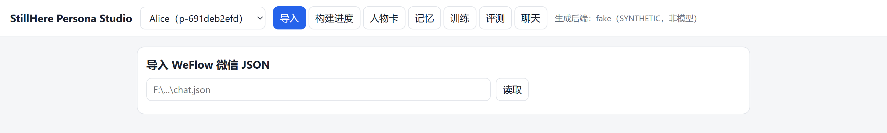

# 快速开始：从聊天导出到可以对话的人物

[English](quickstart.md) · **简体中文** · [繁體中文](quickstart.zh-TW.md)

本教程使用 `examples/synthetic/weflow_demo/` 里的**合成**聊天，Alice 和 Bob 是虚构人物。

- 下面每条命令都在这份示例上实际运行过；
- 输出做了删减，标为**示例输出**；
- 路径按 Linux / macOS 写；在 Windows 上类似 `C:\Users\<你>\.stillhere\personas\...`。

| 部分 | 需要 | 时间 |
|---|---|---|
| [A. 安装](#a-安装) | Python 3.10+ | 2 分钟 |
| [B. 建立人物（只用 CPU）](#b-建立-alice-的人物只用-cpu) | 不需要别的 | 1 分钟 |
| [C. 用 DeepSeek API 聊天](#c-用-deepseek-api-聊天不需要-gpu) | DeepSeek API Key | 2 分钟 |
| [D. 更好的记忆：稠密检索](#d-更好的记忆稠密检索可选) | 约 1.2 GB 下载，CPU 即可 | 10 分钟 |
| [E. 修改人物卡](#e-修改人物卡) | — | 3 分钟 |
| [F. 用新的导出更新记忆](#f-用新的导出更新记忆) | — | 1 分钟 |
| [G. 第二个人物](#g-第二个人物) | — | 1 分钟 |
| [H. 本地 GPU 聊天](#h-用本地-qwen3-8b-聊天cuda-gpu) | NVIDIA GPU，约 16 GB 下载 | — |
| [I. 在 Colab 训练 Adapter](#i-在-google-colab-训练人物-adapter可选) | Google 账号 | 约 1 小时 |
| [J. 使用你自己的聊天](#j-使用你自己的聊天) | WeFlow JSON 导出 | — |
| [故障排除](#故障排除) | | |

---

## A. 安装

```bash
git clone https://github.com/Zamp0x0/StillHere.git StillHere
cd StillHere
python -m venv .venv
source .venv/bin/activate              # Windows PowerShell：.venv\Scripts\Activate.ps1
pip install -e .
stillhere --help
```

- **作用：** 安装 `stillhere` 命令。核心功能只依赖 PyYAML，不需要任何机器学习库。
- **检查：** `stillhere --help` 会列出 `version`、`demo`、`loop-guard`、`persona`；`stillhere persona --help` 会列出所有人物命令。
- **出错时：** 提示 `stillhere: command not found`，说明虚拟环境没有激活。重新激活，或者用 `python -m stillhere.cli --help`。

## B. 建立 Alice 的人物（只用 CPU）

### B1. 先看看导出文件（只读）

```bash
stillhere persona inspect --input examples/synthetic/weflow_demo/alice_bob_weflow.json
```

**示例输出：**

```text
parse:
  messages_in_file: 966
  types: {文本消息: 957, 图片消息: 9}
  first: 2025-03-01T09:21:00+08:00
  last: 2025-06-08T12:29:00+08:00
identity:
  speakers:
    - {"id": "u_fc7273fa69a1", "role": "contact", "messages": 562, "text_messages": 553, ...}
    - {"id": "u_664256a83568", "role": "self", "messages": 404, "text_messages": 404, ...}
  anomalies: []
```

- `contact` 是导出里的对方，也就是 Alice；`self` 是做导出的那个账号，也就是 Bob。
- 这条命令不写入任何东西。

### B2. Quickstart：Profile、清洗、人物卡、记忆

```bash
stillhere persona quickstart --input examples/synthetic/weflow_demo/alice_bob_weflow.json --speaker contact
```

不加 `--speaker` 时，命令会列出两个人让你选；`--speaker contact` 选的是 Alice。

**示例输出：**

```text
Detected speakers:
[1] Alice — 联系人 (contact) — 553 text — 2025-03-01 … 2025-06-08
[2] Bob — 导出账号 (self) — 404 text — 2025-03-01 … 2025-06-08
profile_id: p-691deb2efd
overall: PARTIAL_READY
dense:
  status: SKIPPED
  reason: no local Qwen3-Embedding-0.6B: the product memory runs V2L (lexical)
stages: {01..08: PASS, 09: PENDING, 10: PASS, 11: PASS, 16: PASS, 17: PARTIAL_READY}

not PASS (chat still works unless the stage is 06 / 07 / 16):
  09 semantic_memory: PENDING  [semantic memory needs a writer model (optional); the evidence archive is enough for chat]

profile data (stored only on this machine; sent nowhere unless you choose an API provider): ~/.stillhere/personas/p-691deb2efd
check it any time:    stillhere persona status --profile p-691deb2efd
```

- **做了什么：**
  - 导入 966 条消息；
  - 识别说话人并清洗文本；
  - 生成 train / dev / test 数据集（只有以后训练 Adapter 才会用到）；
  - 自动生成人物卡和提示词；
  - 把每条消息存为证据记忆；
  - 写入 `runtime/runtime_config.json`，使用产品记忆管线 V2D + P2。
- **Profile ID：** `p-691deb2efd` 由文件和说话人决定，同样的输入总是得到同一个 Profile。重复运行是安全的，已完成的阶段会直接复用。
- **`PARTIAL_READY` 是正常的：** 已经可以聊天。可选的语义记忆（需要 writer 模型）和训练相关的阶段不在 quickstart 里运行。
- **文件位置：** `~/.stillhere/personas/p-691deb2efd/`，或者 `$STILLHERE_PERSONA_ROOT/...`。
  - 用 `--root <目录>` 可以换位置。
  - 这个目录不能在 git 仓库里面，除非 git 会忽略它；本仓库的 `.gitignore` 已经忽略了 `profiles/`。

### B3. 查看建好的内容

```bash
stillhere persona status
stillhere persona status --profile p-691deb2efd
```

**示例输出：**

```text
card:            {card_id: c-3bf0e5b9d3d3, review_status: AUTO_GENERATED, versions: 1}
memory:          {memory_status: EVIDENCE_READY, archive_messages: 966, sessions: 100, ...}
dense_index:     {dense_status: NOT_BUILT, embedding_model: None}
memory_pipeline:
  configured: stillhere.persona.product/2026-11-19-v2d-p2
  ACTIVE_MEMORY_PIPELINE_expected: V2L_P2_FALLBACK
adapter:         {enabled: False, installed: []}
```

`V2L_P2_FALLBACK` 的意思是：配置的是产品管线 V2D + P2，但还没有稠密索引，所以现在用的是词法检索加 P2。D 部分会加上稠密索引。

### B4. 看看记忆是怎么工作的（不需要模型）

```bash
stillhere persona memory-query --profile p-691deb2efd --q "西湖改到几号了？"
```

**示例输出（排名靠前的记录，按时间先后）：**

```text
【记忆证据】(… 8 条 …)
[E..] 2025-05-12 …  对方：我5月20号去杭州出差
[E..] 2025-05-12 …  本人：那20号一起去西湖吧
[E..] 2025-05-18 …  本人：西湖改到25号吧，20号我要加班
[E..] 2025-05-18 …  对方：行，那就25号
```

- `本人` 是人物（Alice），`对方` 是另一个人（Bob）。
- 这正是 Reader 回答之前看到的证据。
- 计划从 20 号改到了 25 号，两条记录都带日期保留下来。
- 还可以试试 `"你领养的猫叫什么？"` 和 `"小雨哪天结婚？"`。小雨是 Alice 的姐姐，她的婚礼会记成小雨的事，而不是 Alice 的。

### B5. 带标注的聊天 dry run（不需要模型）

```bash
stillhere persona chat --profile p-691deb2efd --backend fake --message "你好"
```

**示例输出：**

```text
persona chat: card c-3bf0e5b9d3d3 (AUTO_GENERATED), adapter off, memory production (V2L+P2), generator FAKE_DRY_RUN (SYNTHETIC / DRY_RUN_ONLY: not a model)
ACTIVE_MEMORY_PIPELINE: V2L_P2_FALLBACK
note: DENSE_UNAVAILABLE: index NOT_BUILT (stillhere persona memory-build --dense) -> V2L (lexical) fallback
```

假生成器只证明整条链路能跑通：路由、检索、Reader 和人物提示词。**它的文字不是模型的回答。** 要得到真正的回答，请继续看 C（API）或 H（本地 GPU）。

## C. 用 DeepSeek API 聊天（不需要 GPU）

1. 在 DeepSeek 创建 API Key，并在终端里设置。不要写进会提交到 git 的文件。

   ```bash
   export DEEPSEEK_API_KEY=YOUR_API_KEY            # macOS / Linux
   ```

   ```powershell
   $env:DEEPSEEK_API_KEY = "YOUR_API_KEY"          # Windows PowerShell
   ```

   想长期保存，可以在运行 `stillhere` 的目录里建一个 `.env` 文件，写入 `DEEPSEEK_API_KEY=...`。`.env` 已被 git 忽略，格式见 `.env.example`。

2. 可选：检查连接。这只会发送一个很小的请求。

   ```bash
   STILLHERE_ANSWER_PROVIDER=deepseek_api stillhere persona provider check --role answer --allow-external-api
   ```

3. 聊天：

   ```bash
   stillhere persona chat --profile p-691deb2efd --answer-provider deepseek_api --answer-model deepseek-flash --allow-external-api
   ```

**示例会话（真实 API，合成数据）：**

```text
persona chat: ... generator API:deepseek_api:deepseek-flash
ACTIVE_MEMORY_PIPELINE: V2L_P2_FALLBACK
(type a message; /q to quit)
你：西湖改到几号了？
改到25号啦
5月25号，别记错呀
```

- **会发送什么：** 人物提示词、检索到的证据记录和你的消息会发给 DeepSeek。没有 `--allow-external-api`（或 `STILLHERE_ALLOW_EXTERNAL_API=1`）时什么都不会发，报错会写清楚本来要发什么。
- **不需要本地模型：** 用 API 聊天时不会下载 Qwen3-8B。
- **退出：** 输入 `/q`，或按 `Ctrl+D`（Windows 上是 `Ctrl+Z` 再回车）。
- **重新开始：** 再运行同一条命令。Profile 和记忆都会保留，每次聊天从空的对话开始。
- **一直用 DeepSeek：** 在 `.env` 里设置 `STILLHERE_ANSWER_PROVIDER=deepseek_api`、`STILLHERE_ANSWER_MODEL=deepseek-flash`、`STILLHERE_ALLOW_EXTERNAL_API=1`。详见 [providers.md](providers.md)。

## D. 更好的记忆：稠密检索（可选）

稠密检索在词法索引的基础上加入语义匹配（Qwen3-Embedding-0.6B）。CPU 就能运行，有 GPU 会更快。

```bash
pip install -e ".[embedding,download]"
stillhere persona download-model embedding
stillhere persona memory-build --profile p-691deb2efd --dense
stillhere persona status --profile p-691deb2efd
```

- **发生了什么：**
  - `download-model embedding` 把固定版本的模型（约 1.2 GB）下载到 Hugging Face 缓存，StillHere 会自动找到它。也可以加 `--dir <目录>`，再设置 `STILLHERE_EMBEDDING_MODEL_DIR=<目录>`。
  - `memory-build --dense` 建立索引。966 条示例消息在笔记本 CPU 上大约用了 6 分钟。
- **检查：** `status` 会显示 `dense_status: READY` 和 `ACTIVE_MEMORY_PIPELINE_expected: V2D_P2`；`persona chat` 会打印 `ACTIVE_MEMORY_PIPELINE: V2D_P2`。
- **以后模型或索引不见了：** 聊天会回退到 `V2L_P2_FALLBACK`，并打印一行 `note:`。没用到 V2D 时，它绝不会声称在用 V2D。

## E. 修改人物卡

```bash
stillhere persona review --profile p-691deb2efd
```

这会显示人物卡摘要和可以修改的字段：

- `display_name`
- `ai_identity`
- `user_confirmed_facts`
- `addressing_confirmed`
- `extra_style_notes`
- `avoid`

修改方式：

```bash
stillhere persona review --profile p-691deb2efd --edit           # 打开 $EDITOR（Windows 上是记事本），保存为新版本
```

或者复制一份 `cards/<card-id>/persona_card.yaml`，改好后导入：

```bash
stillhere persona review --profile p-691deb2efd --from-file my_card.yaml
stillhere persona finalize --profile p-691deb2efd                # finalize 之后聊天才会用新卡
```

**示例输出：**

```text
card_id: c-69c924892728
review_status: USER_REVIEWED
parent_card: c-3bf0e5b9d3d3
next: stillhere persona finalize --profile p-691deb2efd   (makes chat use the active card; until then chat stops with CONFIG_STALE)
```

- **版本：** 每次修改都会生成新版本，旧版本保留。
  - `stillhere persona card list --profile p-691deb2efd` 列出所有版本；
  - `stillhere persona card show --profile p-691deb2efd` 预览提示词；
  - `stillhere persona card activate --profile p-691deb2efd --card c-3bf0e5b9d3d3` 回退到旧版本；
  - 激活之后要再运行 `persona finalize`。
- **同一时间只用一张卡：** 聊天始终使用当前激活的那一张。
- **用 API 辅助起草（可选）：** `stillhere persona card assist --profile p-691deb2efd --allow-external-api`。默认只发送风格统计；加 `--send-examples` 才会发送示例回复。

## F. 用新的导出更新记忆

`alice_bob_weflow_update.json` 是同一段聊天之后的一次导出，多了 10 天：

```bash
stillhere persona memory-build --profile p-691deb2efd --source examples/synthetic/weflow_demo/alice_bob_weflow_update.json
```

**示例输出：** `evidence: {added: 89, unchanged: 966, archive_messages: 1055, ...}`

- **可以重复运行：** 再运行一次，`added` 是 `0`。
- **更新请用 `memory-build --source`，不要用 quickstart。** 对新的导出运行 quickstart 会建一个*新的* Profile。这时它会提醒你这个人已经有 Profile，并给出 `memory-build --source` 命令。

## G. 第二个人物

从同一份导出建立 Bob，他有自己的人物卡和自己的记忆：

```bash
stillhere persona quickstart --input examples/synthetic/weflow_demo/alice_bob_weflow.json --speaker self
stillhere persona status
```

- **互相隔离：** 每个 Profile 有自己的目录、人物卡版本、SQLite 记忆和运行配置。用 `--profile <bob-profile-id>` 和他聊天；不同 Profile 不会读到彼此的记忆。
- **Studio：** 想在本地网页里浏览 Profile，运行 `stillhere persona studio`，打开 `http://127.0.0.1:8765/`。它只监听 127.0.0.1。



*`persona studio --backend fake` 在合成示例 Profile 上的真实截图。*

## H. 用本地 Qwen3-8B 聊天（CUDA GPU）

支持范围：带 CUDA 的 NVIDIA GPU；Qwen3-8B，或者带 Qwen3 聊天模板的兼容模型目录。

```bash
pip install -e ".[gpu,download]"
stillhere persona doctor --target local-cuda        # GPU、显存、bf16、NF4、库版本
stillhere persona download-model base               # 约 16 GB，固定版本
stillhere persona chat --profile p-691deb2efd --base-dir <printed-path>
```

- **后端：** 默认 `--backend auto` 按实测显存选择；不到 20 GB 时用 `hf-lowvram`，把输入 embedding 放在 CPU 上。也可以自己指定 `--backend hf` 或 `hf-lowvram`。
- **选择 GPU：** `STILLHERE_DEVICE=cuda:1`。
- **显存不够：** 关掉其他占用 GPU 的程序，试试 `--backend hf-lowvram`，或者改用 API（C 部分）。
- **没有 GPU：** 命令会以 `NO_GPU` 停下，并给出 API 和 dry run 两种替代方式。它不会悄悄换成别的 Provider。

## I. 在 Google Colab 训练人物 Adapter（可选）

聊天**不需要**训练，Adapter 默认是关闭的。

```bash
stillhere persona package --profile p-691deb2efd --target colab-l4 --confirm-cloud
```

**示例输出：**

```text
package_id: pk-...
package_dir: ~/.stillhere/personas/p-691deb2efd/packages/pk-.../
notebook: .../StillHere_Persona_L4.ipynb
plan: {rows: 340, steps: 43, checkpoints_expected: [22, 43]}
```

1. **上传：** 把 `package_dir` 里的 4 个文件放到 Google Drive 的 `MyDrive/StillHere/persona/<package-id>/input/`：
   `persona_code.zip`、`persona_data.zip`、`RELEASE_MANIFEST.json`、`SHA256SUMS.txt`。然后用 Colab 打开 Notebook。
2. **运行：** 选择 **L4** GPU 运行时（打包时用 `--target colab-a100` 则选 A100）。只有你接受把训练数据上传到云端时，才在 STAGE 00 里设置 `CONFIRM_PRIVATE_DATA_ON_CLOUD = True`。然后点“全部运行”。
3. **断线了：** 重新连接，用同一个 `RUN_ID` 再点“全部运行”。已完成的阶段和 checkpoint 会从 Drive 复用。
4. **下载：** 结束时 Notebook 把 Adapter ZIP 写到 Drive 的 `runs/<run-id>/exports/` 下。下载后运行：

   ```bash
   stillhere persona import-adapter --profile p-691deb2efd --file <adapter-zip>
   stillhere persona finalize --profile p-691deb2efd --adapter on
   stillhere persona chat --profile p-691deb2efd --base-dir <qwen3-8b-dir>
   ```

- **Base 校验：** Adapter 只能加载到训练时用的 Base 上（Qwen3-8B @ `b968826d`），不匹配会被拒绝。API 模型不能加载 Adapter。
- **示例只用来练习：** 合成示例训练出来的 Adapter 能用但没有意义，真正的价值来自真实聊天。Notebook 里的阶段说明是中文的。

更多内容见 [colab.md](colab.md) 和 [training.md](training.md)，包括本地 GPU 训练（显存 ≥ 20 GiB）和远程训练包。

## J. 使用你自己的聊天

1. 用 WeFlow 把聊天导出为 JSON，文件放在本仓库之外。
2. `stillhere persona inspect --input <导出.json>`：检查两个说话人和可能的异常。
3. `stillhere persona quickstart --input <导出.json>`：选择要建立的那个人。
4. 用你的 Profile ID 继续做 B3–I。

请只使用你有权使用的聊天记录。除非你选择 API Provider，或者自己上传训练包，所有数据都只留在你的电脑上。详见 [privacy.md](privacy.md)。

## 故障排除

| 现象 | 原因和解决办法 |
|---|---|
| `stillhere: command not found` | 激活虚拟环境，或者用 `python -m stillhere.cli ...` |
| `python` 低于 3.10 | 安装 Python 3.10+；用 `python --version` 检查 |
| `ModuleNotFoundError: stillhere` | 在仓库根目录运行 `pip install -e .` |
| `input file not found` / JSON 错误 | 检查路径；文件必须是 WeFlow 导出的 JSON（`persona inspect` 会显示解析结果） |
| `IDENTITY_ANOMALY` | 导出里说话人的情况不正常：先看列出的异常，确认无害后才加 `--accept-anomalies` 重跑 |
| `--speaker is required in non-interactive mode` | 加上 `--speaker contact` / `self` / `1` / `2` |
| 找不到 Profile ID | `stillhere persona status` 会列出所有 Profile |
| `EXTERNAL_API_NOT_ALLOWED` | 确认可以发送数据后，加 `--allow-external-api`（或设置 `STILLHERE_ALLOW_EXTERNAL_API=1`） |
| `NO_API_KEY` | 在终端或 `.env` 里设置 `DEEPSEEK_API_KEY` |
| `HTTP 401` / `HTTP 429` | Key 不对 / 请求太频繁或余额不足；4xx 错误不会重试 |
| `NO_GPU` | 没有 CUDA GPU：用 API（C 部分），或用 `--backend fake` 做 dry run |
| CUDA out of memory | 关掉其他 GPU 程序，用 `--backend hf-lowvram`，或改用 API |
| 找不到模型 / tokenizer | 运行 `stillhere persona download-model base`，把打印出的路径作为 `--base-dir` |
| `CONFIG_STALE` | 当前人物卡变了：运行 `stillhere persona finalize --profile <id>` |
| `note: DENSE_UNAVAILABLE ... -> V2L` | 没有 embedding 模型或索引：看 D 部分，或者继续用 V2L + P2 |
| `ROOT_NOT_PRIVATE` | Profile 目录在 git 仓库里：用默认位置，或用 `./profiles` 这种已被忽略的目录 |
| 对新的导出运行 quickstart，多出一个 Profile | 用 `memory-build --profile <id> --source <newer-export.json>` 更新原来那个 |

更多情况（Colab、SQLite、Windows 路径）见 [troubleshooting.md](troubleshooting.md)。
