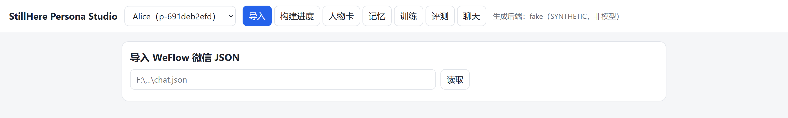

# 快速開始：從聊天匯出到可以對話的人物

[English](quickstart.md) · [简体中文](quickstart.zh-CN.md) · **繁體中文**

本教學使用 `examples/synthetic/weflow_demo/` 中的**合成**聊天，Alice 與 Bob 是虛構人物。

- 下面每個指令都在這份範例上實際執行過；
- 輸出經過刪減，標示為**範例輸出**；
- 路徑以 Linux / macOS 表示；在 Windows 上類似 `C:\Users\<你>\.stillhere\personas\...`；
- 範例聊天的內容是簡體中文，所以查詢與輸出也保留簡體字。

| 部分 | 需要 | 時間 |
|---|---|---|
| [A. 安裝](#a-安裝) | Python 3.10+ | 2 分鐘 |
| [B. 建立人物（只用 CPU）](#b-建立-alice-的人物只用-cpu) | 不需要其他東西 | 1 分鐘 |
| [C. 用 DeepSeek API 聊天](#c-用-deepseek-api-聊天不需要-gpu) | DeepSeek API Key | 2 分鐘 |
| [D. 更好的記憶：稠密檢索](#d-更好的記憶稠密檢索選用) | 約 1.2 GB 下載，CPU 即可 | 10 分鐘 |
| [E. 修改人物卡](#e-修改人物卡) | — | 3 分鐘 |
| [F. 用新的匯出更新記憶](#f-用新的匯出更新記憶) | — | 1 分鐘 |
| [G. 第二個人物](#g-第二個人物) | — | 1 分鐘 |
| [H. 本機 GPU 聊天](#h-用本機-qwen3-8b-聊天cuda-gpu) | NVIDIA GPU，約 16 GB 下載 | — |
| [I. 在 Colab 訓練 Adapter](#i-在-google-colab-訓練人物-adapter選用) | Google 帳號 | 約 1 小時 |
| [J. 使用你自己的聊天](#j-使用你自己的聊天) | WeFlow JSON 匯出 | — |
| [疑難排解](#疑難排解) | | |

---

## A. 安裝

```bash
git clone https://github.com/Zamp0x0/StillHere.git StillHere
cd StillHere
python -m venv .venv
source .venv/bin/activate              # Windows PowerShell：.venv\Scripts\Activate.ps1
pip install -e .
stillhere --help
```

- **作用：** 安裝 `stillhere` 指令。核心功能只依賴 PyYAML，不需要任何機器學習函式庫。
- **檢查：** `stillhere --help` 會列出 `version`、`demo`、`loop-guard`、`persona`；`stillhere persona --help` 會列出所有人物指令。
- **發生錯誤時：** 出現 `stillhere: command not found`，表示虛擬環境沒有啟用。重新啟用，或改用 `python -m stillhere.cli --help`。

## B. 建立 Alice 的人物（只用 CPU）

### B1. 先檢視匯出檔（唯讀）

```bash
stillhere persona inspect --input examples/synthetic/weflow_demo/alice_bob_weflow.json
```

**範例輸出：**

```text
parse:
  messages_in_file: 966
  types: {文本消息: 957, 图片消息: 9}
  first: 2025-03-01T09:21:00+08:00
  last: 2025-06-08T12:29:00+08:00
identity:
  speakers:
    - {"id": "u_fc7273fa69a1", "role": "contact", "messages": 562, "text_messages": 553, ...}
    - {"id": "u_664256a83568", "role": "self", "messages": 404, "text_messages": 404, ...}
  anomalies: []
```

- `contact` 是匯出中的對方，也就是 Alice；`self` 是進行匯出的帳號，也就是 Bob。
- 這個指令不會寫入任何東西。

### B2. Quickstart：Profile、清理、人物卡、記憶

```bash
stillhere persona quickstart --input examples/synthetic/weflow_demo/alice_bob_weflow.json --speaker contact
```

不加 `--speaker` 時，指令會列出兩個人讓你選擇；`--speaker contact` 選的是 Alice。

**範例輸出：**

```text
Detected speakers:
[1] Alice — 联系人 (contact) — 553 text — 2025-03-01 … 2025-06-08
[2] Bob — 导出账号 (self) — 404 text — 2025-03-01 … 2025-06-08
profile_id: p-691deb2efd
overall: PARTIAL_READY
dense:
  status: SKIPPED
  reason: no local Qwen3-Embedding-0.6B: the product memory runs V2L (lexical)
stages: {01..08: PASS, 09: PENDING, 10: PASS, 11: PASS, 16: PASS, 17: PARTIAL_READY}

not PASS (chat still works unless the stage is 06 / 07 / 16):
  09 semantic_memory: PENDING  [semantic memory needs a writer model (optional); the evidence archive is enough for chat]

profile data (stored only on this machine; sent nowhere unless you choose an API provider): ~/.stillhere/personas/p-691deb2efd
check it any time:    stillhere persona status --profile p-691deb2efd
```

- **做了什麼：**
  - 匯入 966 則訊息；
  - 辨識說話者並清理文字；
  - 產生 train / dev / test 資料集（之後要訓練 Adapter 才會用到）；
  - 自動產生人物卡與提示詞；
  - 把每則訊息存為證據記憶；
  - 寫入 `runtime/runtime_config.json`，使用產品記憶管線 V2D + P2。
- **Profile ID：** `p-691deb2efd` 由檔案與說話者決定，同樣的輸入一定得到同一個 Profile。重複執行是安全的，已完成的階段會直接沿用。
- **`PARTIAL_READY` 是正常的：** 已經可以聊天。選用的語意記憶（需要 writer 模型）與訓練相關的階段不在 quickstart 中執行。
- **檔案位置：** `~/.stillhere/personas/p-691deb2efd/`，或 `$STILLHERE_PERSONA_ROOT/...`。
  - 用 `--root <資料夾>` 可以換位置。
  - 這個資料夾不能位於 git 儲存庫內，除非 git 會忽略它；本儲存庫的 `.gitignore` 已經忽略 `profiles/`。

### B3. 檢視建立的內容

```bash
stillhere persona status
stillhere persona status --profile p-691deb2efd
```

**範例輸出：**

```text
card:            {card_id: c-3bf0e5b9d3d3, review_status: AUTO_GENERATED, versions: 1}
memory:          {memory_status: EVIDENCE_READY, archive_messages: 966, sessions: 100, ...}
dense_index:     {dense_status: NOT_BUILT, embedding_model: None}
memory_pipeline:
  configured: stillhere.persona.product/2026-11-19-v2d-p2
  ACTIVE_MEMORY_PIPELINE_expected: V2L_P2_FALLBACK
adapter:         {enabled: False, installed: []}
```

`V2L_P2_FALLBACK` 的意思是：設定的是產品管線 V2D + P2，但還沒有稠密索引，所以目前使用詞彙檢索加 P2。D 部分會加上稠密索引。

### B4. 看看記憶如何運作（不需要模型）

```bash
stillhere persona memory-query --profile p-691deb2efd --q "西湖改到几号了？"
```

**範例輸出（排名在前的紀錄，依時間先後）：**

```text
【记忆证据】(… 8 条 …)
[E..] 2025-05-12 …  对方：我5月20号去杭州出差
[E..] 2025-05-12 …  本人：那20号一起去西湖吧
[E..] 2025-05-18 …  本人：西湖改到25号吧，20号我要加班
[E..] 2025-05-18 …  对方：行，那就25号
```

- `本人` 是人物（Alice），`对方` 是另一個人（Bob）。
- 這正是 Reader 回答前看到的證據。
- 計畫從 20 號改到 25 號，兩則紀錄都帶著日期保留下來。
- 也可以試試 `"你领养的猫叫什么？"` 與 `"小雨哪天结婚？"`。小雨是 Alice 的姊姊，她的婚禮會記為小雨的事，而不是 Alice 的。

### B5. 有標示的聊天 dry run（不需要模型）

```bash
stillhere persona chat --profile p-691deb2efd --backend fake --message "你好"
```

**範例輸出：**

```text
persona chat: card c-3bf0e5b9d3d3 (AUTO_GENERATED), adapter off, memory production (V2L+P2), generator FAKE_DRY_RUN (SYNTHETIC / DRY_RUN_ONLY: not a model)
ACTIVE_MEMORY_PIPELINE: V2L_P2_FALLBACK
note: DENSE_UNAVAILABLE: index NOT_BUILT (stillhere persona memory-build --dense) -> V2L (lexical) fallback
```

假產生器只證明整條流程可以跑通：路由、檢索、Reader 與人物提示詞。**它的文字不是模型的回答。** 要得到真正的回答，請接著看 C（API）或 H（本機 GPU）。

## C. 用 DeepSeek API 聊天（不需要 GPU）

1. 在 DeepSeek 建立 API Key，並在終端機中設定。不要寫進會提交到 git 的檔案。

   ```bash
   export DEEPSEEK_API_KEY=YOUR_API_KEY            # macOS / Linux
   ```

   ```powershell
   $env:DEEPSEEK_API_KEY = "YOUR_API_KEY"          # Windows PowerShell
   ```

   想長期保存，可以在執行 `stillhere` 的資料夾建立 `.env` 檔，寫入 `DEEPSEEK_API_KEY=...`。`.env` 已被 git 忽略，格式請見 `.env.example`。

2. 選用：檢查連線。這只會送出一個很小的請求。

   ```bash
   STILLHERE_ANSWER_PROVIDER=deepseek_api stillhere persona provider check --role answer --allow-external-api
   ```

3. 聊天：

   ```bash
   stillhere persona chat --profile p-691deb2efd --answer-provider deepseek_api --answer-model deepseek-flash --allow-external-api
   ```

**範例對話（真實 API，合成資料）：**

```text
persona chat: ... generator API:deepseek_api:deepseek-flash
ACTIVE_MEMORY_PIPELINE: V2L_P2_FALLBACK
(type a message; /q to quit)
你：西湖改到几号了？
改到25号啦
5月25号，别记错呀
```

- **會傳送什麼：** 人物提示詞、檢索到的證據紀錄與你的訊息會傳給 DeepSeek。沒有 `--allow-external-api`（或 `STILLHERE_ALLOW_EXTERNAL_API=1`）時什麼都不會送出，錯誤訊息會寫清楚原本要送出什麼。
- **不需要本機模型：** 使用 API 聊天時不會下載 Qwen3-8B。
- **離開：** 輸入 `/q`，或按 `Ctrl+D`（Windows 上是 `Ctrl+Z` 再按 Enter）。
- **重新開始：** 再執行同一個指令。Profile 與記憶都會保留，每次聊天從空的對話開始。
- **一直使用 DeepSeek：** 在 `.env` 中設定 `STILLHERE_ANSWER_PROVIDER=deepseek_api`、`STILLHERE_ANSWER_MODEL=deepseek-flash`、`STILLHERE_ALLOW_EXTERNAL_API=1`。詳見 [providers.md](providers.md)。

## D. 更好的記憶：稠密檢索（選用）

稠密檢索在詞彙索引之上加入語意比對（Qwen3-Embedding-0.6B）。CPU 就能執行，有 GPU 會更快。

```bash
pip install -e ".[embedding,download]"
stillhere persona download-model embedding
stillhere persona memory-build --profile p-691deb2efd --dense
stillhere persona status --profile p-691deb2efd
```

- **發生了什麼：**
  - `download-model embedding` 把固定版本的模型（約 1.2 GB）下載到 Hugging Face 快取，StillHere 會自動找到它。也可以加上 `--dir <資料夾>`，再設定 `STILLHERE_EMBEDDING_MODEL_DIR=<資料夾>`。
  - `memory-build --dense` 建立索引。966 則範例訊息在筆電 CPU 上大約花了 6 分鐘。
- **檢查：** `status` 會顯示 `dense_status: READY` 與 `ACTIVE_MEMORY_PIPELINE_expected: V2D_P2`；`persona chat` 會印出 `ACTIVE_MEMORY_PIPELINE: V2D_P2`。
- **之後模型或索引不見了：** 聊天會退回 `V2L_P2_FALLBACK`，並印出一行 `note:`。沒有用到 V2D 時，它絕不會宣稱正在使用 V2D。

## E. 修改人物卡

```bash
stillhere persona review --profile p-691deb2efd
```

這會顯示人物卡摘要與可以修改的欄位：

- `display_name`
- `ai_identity`
- `user_confirmed_facts`
- `addressing_confirmed`
- `extra_style_notes`
- `avoid`

修改方式：

```bash
stillhere persona review --profile p-691deb2efd --edit           # 開啟 $EDITOR（Windows 上是記事本），儲存為新版本
```

或者複製一份 `cards/<card-id>/persona_card.yaml`，修改後匯入：

```bash
stillhere persona review --profile p-691deb2efd --from-file my_card.yaml
stillhere persona finalize --profile p-691deb2efd                # finalize 之後聊天才會使用新卡
```

**範例輸出：**

```text
card_id: c-69c924892728
review_status: USER_REVIEWED
parent_card: c-3bf0e5b9d3d3
next: stillhere persona finalize --profile p-691deb2efd   (makes chat use the active card; until then chat stops with CONFIG_STALE)
```

- **版本：** 每次修改都會產生新版本，舊版本保留。
  - `stillhere persona card list --profile p-691deb2efd` 列出所有版本；
  - `stillhere persona card show --profile p-691deb2efd` 預覽提示詞；
  - `stillhere persona card activate --profile p-691deb2efd --card c-3bf0e5b9d3d3` 回到舊版本；
  - 啟用之後要再執行 `persona finalize`。
- **同一時間只用一張卡：** 聊天一律使用目前啟用的那一張。
- **用 API 協助起草（選用）：** `stillhere persona card assist --profile p-691deb2efd --allow-external-api`。預設只傳送風格統計；加上 `--send-examples` 才會傳送範例回覆。

## F. 用新的匯出更新記憶

`alice_bob_weflow_update.json` 是同一段聊天之後的一次匯出，多了 10 天：

```bash
stillhere persona memory-build --profile p-691deb2efd --source examples/synthetic/weflow_demo/alice_bob_weflow_update.json
```

**範例輸出：** `evidence: {added: 89, unchanged: 966, archive_messages: 1055, ...}`

- **可以重複執行：** 再執行一次，`added` 是 `0`。
- **更新請用 `memory-build --source`，不要用 quickstart。** 對新的匯出執行 quickstart 會建立一個*新的* Profile。這時它會提醒你這個人已經有 Profile，並給出 `memory-build --source` 指令。

## G. 第二個人物

從同一份匯出建立 Bob，他有自己的人物卡與自己的記憶：

```bash
stillhere persona quickstart --input examples/synthetic/weflow_demo/alice_bob_weflow.json --speaker self
stillhere persona status
```

- **互相隔離：** 每個 Profile 都有自己的資料夾、人物卡版本、SQLite 記憶與執行設定。用 `--profile <bob-profile-id>` 與他聊天；不同 Profile 不會讀到彼此的記憶。
- **Studio：** 想在本機網頁瀏覽 Profile，執行 `stillhere persona studio`，開啟 `http://127.0.0.1:8765/`。它只監聽 127.0.0.1。



*`persona studio --backend fake` 在合成範例 Profile 上的真實截圖。*

## H. 用本機 Qwen3-8B 聊天（CUDA GPU）

支援範圍：具備 CUDA 的 NVIDIA GPU；Qwen3-8B，或具有 Qwen3 聊天範本的相容模型資料夾。

```bash
pip install -e ".[gpu,download]"
stillhere persona doctor --target local-cuda        # GPU、顯示記憶體、bf16、NF4、函式庫版本
stillhere persona download-model base               # 約 16 GB，固定版本
stillhere persona chat --profile p-691deb2efd --base-dir <printed-path>
```

- **後端：** 預設 `--backend auto` 依實測顯示記憶體選擇；少於 20 GB 時使用 `hf-lowvram`，把輸入 embedding 放在 CPU。也可以自行指定 `--backend hf` 或 `hf-lowvram`。
- **選擇 GPU：** `STILLHERE_DEVICE=cuda:1`。
- **顯示記憶體不足：** 關閉其他使用 GPU 的程式，試試 `--backend hf-lowvram`，或改用 API（C 部分）。
- **沒有 GPU：** 指令會以 `NO_GPU` 停止，並列出 API 與 dry run 兩種替代方式。它不會悄悄換成別的 Provider。

## I. 在 Google Colab 訓練人物 Adapter（選用）

聊天**不需要**訓練，Adapter 預設是關閉的。

```bash
stillhere persona package --profile p-691deb2efd --target colab-l4 --confirm-cloud
```

**範例輸出：**

```text
package_id: pk-...
package_dir: ~/.stillhere/personas/p-691deb2efd/packages/pk-.../
notebook: .../StillHere_Persona_L4.ipynb
plan: {rows: 340, steps: 43, checkpoints_expected: [22, 43]}
```

1. **上傳：** 把 `package_dir` 中的 4 個檔案放到 Google Drive 的 `MyDrive/StillHere/persona/<package-id>/input/`：
   `persona_code.zip`、`persona_data.zip`、`RELEASE_MANIFEST.json`、`SHA256SUMS.txt`。然後用 Colab 開啟 Notebook。
2. **執行：** 選擇 **L4** GPU 執行階段（打包時用 `--target colab-a100` 則選 A100）。只有在你接受把訓練資料上傳到雲端時，才在 STAGE 00 設定 `CONFIRM_PRIVATE_DATA_ON_CLOUD = True`。然後點選「全部執行」。
3. **斷線了：** 重新連線，用同一個 `RUN_ID` 再點選「全部執行」。已完成的階段與 checkpoint 會從 Drive 沿用。
4. **下載：** 結束時 Notebook 會把 Adapter ZIP 寫到 Drive 的 `runs/<run-id>/exports/` 下。下載後執行：

   ```bash
   stillhere persona import-adapter --profile p-691deb2efd --file <adapter-zip>
   stillhere persona finalize --profile p-691deb2efd --adapter on
   stillhere persona chat --profile p-691deb2efd --base-dir <qwen3-8b-dir>
   ```

- **Base 檢查：** Adapter 只能載入到訓練時使用的 Base（Qwen3-8B @ `b968826d`），不符合會被拒絕。API 模型不能載入 Adapter。
- **範例只用來練習：** 合成範例訓練出的 Adapter 可以運作但沒有意義，真正的價值來自真實聊天。Notebook 中的階段說明是中文。

更多內容請見 [colab.md](colab.md) 與 [training.md](training.md)，包括本機 GPU 訓練（顯示記憶體 ≥ 20 GiB）與遠端訓練套件。

## J. 使用你自己的聊天

1. 用 WeFlow 把聊天匯出為 JSON，檔案放在本儲存庫之外。
2. `stillhere persona inspect --input <匯出.json>`：檢查兩位說話者與可能的異常。
3. `stillhere persona quickstart --input <匯出.json>`：選擇要建立的那個人。
4. 用你的 Profile ID 繼續進行 B3–I。

請只使用你有權使用的聊天紀錄。除非你選擇 API Provider，或自行上傳訓練套件，所有資料都只留在你的電腦上。詳見 [privacy.md](privacy.md)。

## 疑難排解

| 症狀 | 原因與解決方式 |
|---|---|
| `stillhere: command not found` | 啟用虛擬環境，或改用 `python -m stillhere.cli ...` |
| `python` 低於 3.10 | 安裝 Python 3.10+；用 `python --version` 檢查 |
| `ModuleNotFoundError: stillhere` | 在儲存庫根目錄執行 `pip install -e .` |
| `input file not found` / JSON 錯誤 | 檢查路徑；檔案必須是 WeFlow 匯出的 JSON（`persona inspect` 會顯示解析結果） |
| `IDENTITY_ANOMALY` | 匯出中說話者的情況不正常：先看列出的異常，確認無害後才加上 `--accept-anomalies` 重新執行 |
| `--speaker is required in non-interactive mode` | 加上 `--speaker contact` / `self` / `1` / `2` |
| 找不到 Profile ID | `stillhere persona status` 會列出所有 Profile |
| `EXTERNAL_API_NOT_ALLOWED` | 確認可以傳送資料後，加上 `--allow-external-api`（或設定 `STILLHERE_ALLOW_EXTERNAL_API=1`） |
| `NO_API_KEY` | 在終端機或 `.env` 中設定 `DEEPSEEK_API_KEY` |
| `HTTP 401` / `HTTP 429` | Key 錯誤 / 請求太頻繁或餘額不足；4xx 錯誤不會重試 |
| `NO_GPU` | 沒有 CUDA GPU：使用 API（C 部分），或用 `--backend fake` 做 dry run |
| CUDA out of memory | 關閉其他 GPU 程式，使用 `--backend hf-lowvram`，或改用 API |
| 找不到模型 / tokenizer | 執行 `stillhere persona download-model base`，把印出的路徑當作 `--base-dir` |
| `CONFIG_STALE` | 目前的人物卡變了：執行 `stillhere persona finalize --profile <id>` |
| `note: DENSE_UNAVAILABLE ... -> V2L` | 沒有 embedding 模型或索引：請看 D 部分，或繼續使用 V2L + P2 |
| `ROOT_NOT_PRIVATE` | Profile 資料夾位於 git 儲存庫內：使用預設位置，或使用 `./profiles` 這類已被忽略的資料夾 |
| 對新的匯出執行 quickstart，多出一個 Profile | 用 `memory-build --profile <id> --source <newer-export.json>` 更新原本那個 |

更多情況（Colab、SQLite、Windows 路徑）請見 [troubleshooting.md](troubleshooting.md)。
