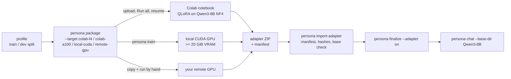

# Training a persona adapter (optional, advanced)

Chatting does **not** need training: the default persona is the prompt-only Persona Skill, and the adapter is off by default. Train
an adapter only if you want to experiment with fine-tuned style.

## What is trained

| | |
|---|---|
| Method | QLoRA with LLaMA-Factory (installed inside the training environment) |
| Base | `Qwen/Qwen3-8B` @ `b968826d`, NF4 4-bit, bf16 compute |
| Data | the profile's train / dev split (target replies only; the other person's messages are context) |
| Config | `training/persona/configs/persona_qlora.yaml` (L4), `persona_qlora_r2_a100.yaml` (A100); pass another with `--config` |
| Output | checkpoints, a checkpoint chosen on dev by a pre-registered rule, an adapter ZIP with a manifest |
| Data gate | at least 200 train samples (`persona status` shows the dataset gate) |



## Three ways to train

| Way | Status | Commands |
|---|---|---|
| **A. Google Colab** (L4 / A100) | used for the project's own training runs | `persona package --target colab-l4` (or `colab-a100`) `--confirm-cloud`; see [colab.md](colab.md) |
| **B. Local CUDA GPU** | implemented; CPU dry-run tested, not verified on local hardware by the project | `persona doctor --target local-cuda`, then `persona package --target local-cuda`, then `persona train` |
| **C. Remote GPU** (your own server) | **package only**: StillHere builds the package and the instructions; you copy and run it yourself | `persona package --target remote-gpu --confirm-cloud` |

### B. Local GPU

```bash
pip install -e ".[gpu]"
stillhere persona doctor --target local-cuda                       # refuses below 20 GiB VRAM, missing bf16 / NF4 or wrong versions
stillhere persona package --profile <profile-id> --target local-cuda
stillhere persona train --profile <profile-id> --package <package-id> --dry-run       # checks everything, trains nothing
stillhere persona train --profile <profile-id> --package <package-id> --gpu 0         # CUDA_VISIBLE_DEVICES=0
```

- `--smoke-only` runs a 1–2 step smoke test.
- The run writes checkpoints under the profile's `runs/` folder and records a job file.
- Import the result as in [colab.md](colab.md#4-import-the-adapter).

### C. Remote GPU

`--target remote-gpu` writes a package with `persona_code.zip`, `persona_data.zip`, `SHA256SUMS.txt` and a README with the
commands:

1. copy the files (for example with `scp`);
2. check them with `sha256sum -c`;
3. unzip;
4. install the pinned requirements;
5. run the smoke test, then the training command.

There is **no** automatic remote scheduling. Bring the adapter ZIP back with `persona import-adapter`.

## Import and use an adapter

```bash
stillhere persona import-adapter --profile <profile-id> --file <adapter-zip>
stillhere persona finalize --profile <profile-id> --adapter on
stillhere persona chat --profile <profile-id> --base-dir <qwen3-8b-dir>
```

- The import verifies the ZIP manifest and hashes, that the weights are LoRA weights only, that the checkpoint was the selected
  one, and that the base matches.
- A mismatched adapter is refused.
- Adapters do not run on API models (`ADAPTER_NEEDS_LOCAL_BASE`).
- To turn it off again: `persona finalize --profile <id> --adapter off`.

## A note on results

In the project's own evaluation, the trained adapters did not clearly beat the prompt-only persona:

- one showed a "conditional collapse" (repetitive, generic replies) under the Skill prompt;
- the next round removed the collapse but scored about the same.

That is why the adapter stays opt-in. See [limitations.md](limitations.md).
